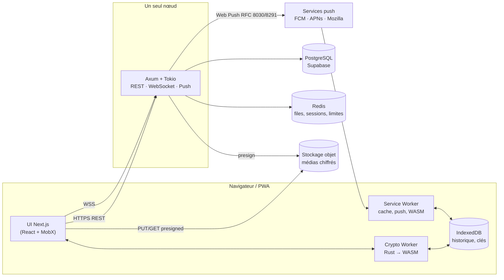
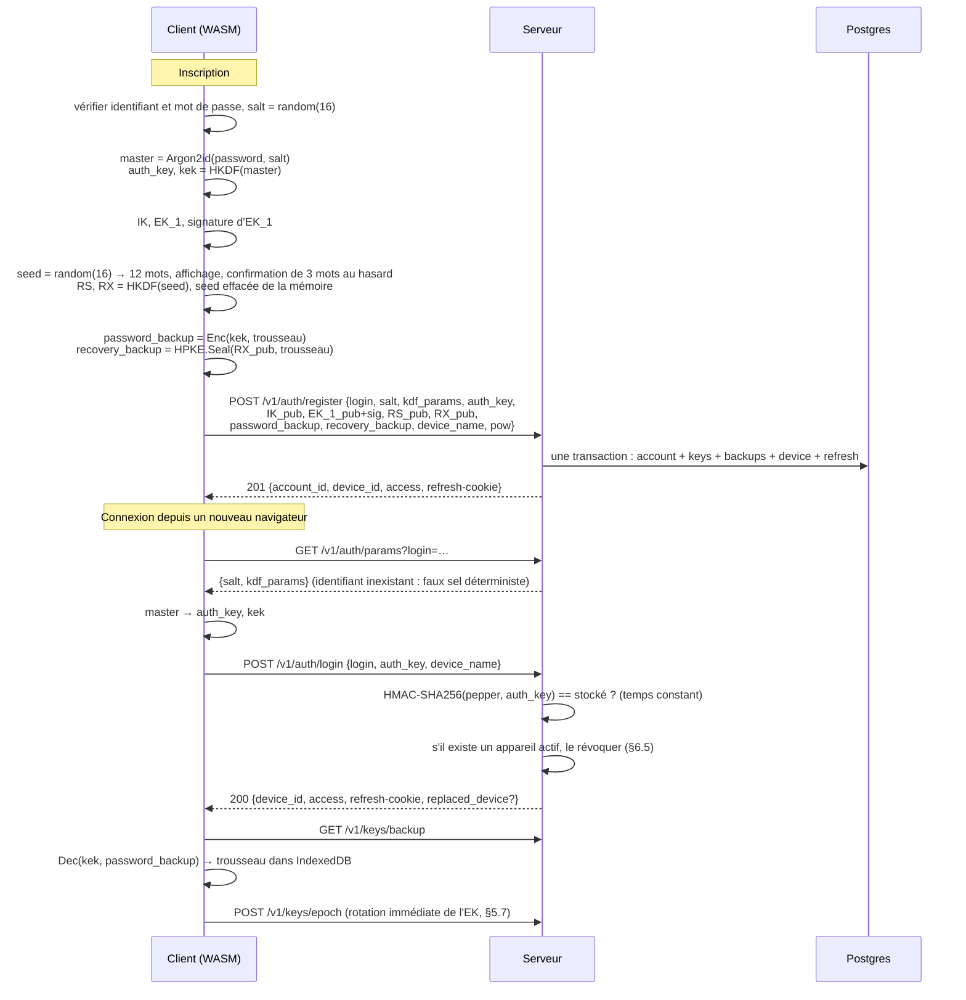
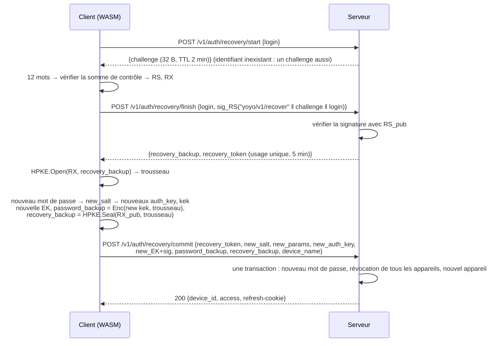
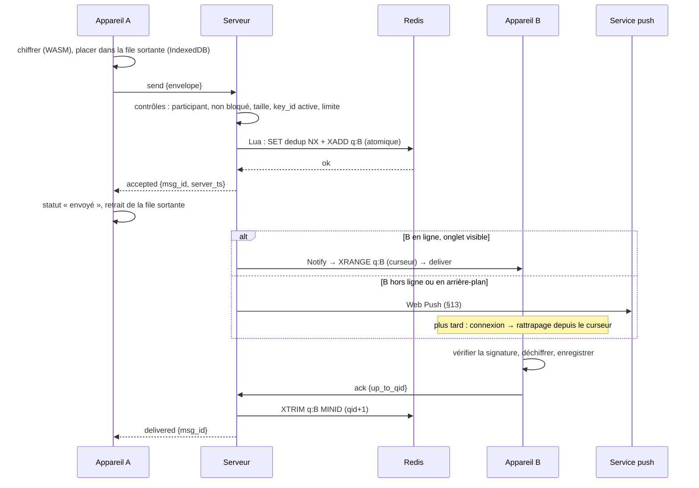

# YoYo Messenger — spécification du service

> Version française de [SPEC.md](SPEC.md). En cas d'écart, la version russe fait foi : c'est elle qui a été rédigée et affinée avec les prompts de [PROMPT.md](PROMPT.md).

**Statut :** v0.3. Avant-projet précisé par les réponses du commanditaire (Q1–Q6, Q9, Q11 — §19) : un seul appareil par compte, conversations privées uniquement, récupération par phrase seed, modification et suppression des messages, médias conservés 30 jours, preuve de travail à l'inscription, connexion sans OPAQUE.
**Périmètre :** messagerie web (navigateur + PWA sur mobile), backend + frontend. L'implémentation n'est pas incluse.

---

## 1. Objectifs et périmètre

### Objectifs

1. Conversations privées en tête-à-tête dans le navigateur et dans la PWA sur téléphone : texte, images, réactions, modification et suppression.
2. Chiffrement de bout en bout « sans la complexité de Signal » : le serveur ne stocke et ne relaie que du chiffré, mais le protocole tient sur une page et une seule équipe peut l'implémenter.
3. Livraison en temps réel via WebSocket ; aucun message n'est perdu pendant que le destinataire est hors ligne.
4. Notifications lorsque l'application est fermée (§13).
5. Exploitation simple : un seul serveur en Rust (Axum + Tokio), PostgreSQL (Supabase), Redis.

### Étapes

| Étape | Contenu |
|---|---|
| **v1** (cette spécification) | Conversations privées, **un seul appareil actif par compte**, historique à partir de la connexion, récupération par phrase seed |
| **Étape 2** | Groupes, plusieurs appareils simultanés (§16.1) |

### Hors périmètre v1

- Double Ratchet, prekeys à usage unique, MLS. Pourquoi : §5.9.
- Groupes et utilisation simultanée sur plusieurs appareils : étape 2.
- Indicateur de saisie et statut en ligne / « vu à ». Les utilisateurs masquent de plus en plus ces données eux-mêmes, et un serveur qui ne les collecte pas ne peut pas les divulguer.
- Appels, stories, canaux, bots, fédération.
- Masquage des métadonnées vis-à-vis du serveur (qui parle à qui, quand). Le serveur les voit, et le modèle de menace le dit explicitement.
- Applications natives. La voie vers elles est décrite au §13.6.

### Hypothèses de charge (à confirmer)

| Paramètre | v1 | Marge d'un nœud |
|---|---|---|
| Comptes inscrits | 10 000 | — |
| WebSocket simultanés | 2 000 | ≥ 20 000 |
| Messages en pointe | 50/s | ≥ 1 000/s |
| Taille d'une image | jusqu'à 10 Mo après compression côté client | — |

---

## 2. Exigences

### 2.1 Fonctionnelles

| ID | Exigence |
|---|---|
| F1 | Inscription par identifiant et mot de passe. Identifiant ASCII, 3 caractères minimum (§6.1). Mot de passe robuste (§6.2). |
| F2 | Connexion depuis n'importe quel navigateur avec identifiant et mot de passe. Les clés de chiffrement sont restaurées depuis une sauvegarde chiffrée (§5.4). Une connexion sur un nouvel appareil met fin à la session sur l'ancien (un seul appareil actif). Sur le nouvel appareil, l'historique commence à la connexion, plus ce qui restait non livré dans la file. |
| F3 | Recherche d'un interlocuteur par identifiant exact, création d'une conversation privée. |
| F4 | Messages texte (jusqu'à 4 096 caractères). |
| F5 | Images avec aperçu ; compressées et débarrassées des métadonnées EXIF côté client. |
| F6 | Réactions emoji sur un message : ajouter et retirer, plusieurs emoji différents par utilisateur. |
| F7 | Statuts « envoyé » → « distribué » → « lu ». Les accusés de lecture sont désactivables ; l'utilisateur ne voit alors pas non plus ceux des autres (comme WhatsApp). |
| F8 | File hors ligne : un message attend son destinataire jusqu'à 30 jours. |
| F9 | Notifications push lorsque l'application est fermée, avec ou sans aperçu (réglage). |
| F10 | Informations sur l'appareil actif et journal des connexions ; « se déconnecter partout ». |
| F11 | Vérification des clés de l'interlocuteur (code de sécurité / QR) et avertissement en cas de changement de clé. |
| F12 | Changement de mot de passe sans perte des clés ni de l'historique. |
| F13 | Modification de son propre message texte ou de la légende d'une image pendant 24 h ; le destinataire voit la mention « modifié ». |
| F14 | Suppression d'un message : « pour moi » à tout moment ; « pour tous » pour ses propres messages pendant 24 h, avec à la place « Message supprimé ». |
| F15 | Récupération de l'accès par une phrase seed de 12 mots en cas d'oubli du mot de passe, sans perte des clés, sans e-mail ni intervention de l'opérateur (§6.6). |

### 2.2 Non fonctionnelles

| ID | Exigence | Cible |
|---|---|---|
| N1 | Latence de livraison à un destinataire en ligne (accept → deliver) | p95 < 300 ms |
| N2 | Un message accepté par le serveur n'est jamais perdu | RPO = 0 pour `accepted` (§10.2) |
| N3 | Un renvoi ne crée pas de doublon | idempotence par `msg_id` |
| N4 | Le serveur ne stocke en clair ni messages, ni médias, ni réactions, ni modifications | vérifié par un test sur les dumps de la base et de Redis |
| N5 | Démarrage à froid de la PWA sur un téléphone moyen | < 2 s jusqu'à la liste des conversations depuis le cache local |
| N6 | Disponibilité v1 | 99,5 % par mois ; redémarrages planifiés sans perte de messages |
| N7 | Données dans l'UE | région Supabase et stockage dans l'UE (RGPD) |

---

## 3. Modèle de menace

### 3.1 Ce que le serveur sait et ne sait pas

| Sait | Ne sait pas |
|---|---|
| Identifiant, date d'inscription, appareil actif, IP | Mot de passe (il ne reçoit qu'un `auth_key` dérivé, §6.3) ni phrase seed (seulement ses clés publiques) |
| Qu'une récupération d'accès a eu lieu | Les liens entre messages : qu'il s'agit d'une modification, d'une suppression ou d'une réaction, et à quel message elle se rapporte |
| Qui est dans quelle conversation, l'heure et la taille (avec bourrage) de chaque message | Le texte, le type de message (texte / image / réaction / accusé) |
| La taille d'un fichier média chiffré | Son contenu, ses dimensions en pixels, sa légende |
| La remise à l'appareil | La lecture (l'accusé de lecture est chiffré) |
| Les clés publiques | Les clés privées ; la sauvegarde est chiffrée par une clé dérivée du mot de passe |
| L'endpoint push de l'appareil | Le contenu de la notification push |

### 3.2 Adversaires

| Adversaire | Protection |
|---|---|
| Fuite de la base / de Redis / du stockage des médias | Uniquement du chiffré et des clés publiques. La sauvegarde des clés est exactement aussi solide que le mot de passe : Argon2id + exigences sur le mot de passe. |
| Opérateur du serveur curieux | Ne lit pas le contenu. Voit les métadonnées (§3.1). |
| Serveur malveillant qui substitue la clé d'un interlocuteur | TOFU + avertissement de changement de clé + vérification du code de sécurité (F11). |
| Serveur malveillant qui sert un JS modifié | **Pas entièrement couvert** — problème commun à tout E2E sur le web. Atténuation : CSP, SRI, build reproductible avec hachés publiés, cache de l'app shell dans le Service Worker. Voir §12.6. |
| XSS côté client | CSP stricte, Trusted Types, aucun script tiers, crypto dans un Worker séparé. Un XSS équivaut à une compromission du compte : c'est le risque principal côté client. |
| Interception du trafic | TLS 1.3 + E2E. |
| Attaque en ligne sur le mot de passe | Limites par identifiant et par IP (§7.6). |
| Appareil volé | « Se déconnecter partout » depuis un autre navigateur (ou récupération par phrase seed) + rotation de la clé d'époque ; verrouillage par mot de passe en option. |
| Force brute ou vol de la phrase seed | 128 bits d'entropie : force brute impossible. Voler la phrase revient à prendre le compte. L'utilisateur la conserve hors ligne, ce qui lui est dit à l'inscription. Chaque récupération déconnecte l'appareil actif et change la clé d'époque, donc le propriétaire la remarque. |
| Compromission de la boîte mail | L'e-mail ne participe pas à la récupération ; sa compromission n'ouvre pas le compte (D10). |
| Le destinataire n'applique pas « supprimer pour tous » | Non couvert : un client modifié peut garder le message, et une notification a pu afficher le texte. « Supprimer pour tous » est une politesse du protocole, pas une garantie, et l'interface le dit. |

### 3.3 Hors périmètre v1

Anonymat de l'expéditeur (sealed sender), masquage du graphe social, protection contre un OS ou un navigateur compromis, déni plausible.

---

## 4. Architecture



### 4.1 Composants

| Composant | Responsabilité |
|---|---|
| **`yoyo-proto`** (crate Rust) | Types des enveloppes et des trames, sérialisation (MessagePack), versions du protocole. Compilé en natif pour le serveur et en WASM pour le client : une seule source de vérité. |
| **`yoyo-crypto`** (crate Rust → WASM) | Côté client uniquement : KDF, génération et stockage des clés, chiffrement des messages et des médias, signatures, codes de sécurité. |
| **Client Next.js** | UI, état, réseau. Ne manipule jamais les clés directement, uniquement via le Crypto Worker. |
| **Service Worker** | Cache de l'app shell (démarrage hors ligne), réception du Web Push, déchiffrement de l'aperçu avec le même WASM. |
| **Serveur Axum** | Authentification, annuaire de clés, conversations et participants, réception et distribution des enveloppes, presign des médias, envoi Web Push, métriques. |
| **PostgreSQL** | Tout ce qui est durable, sauf les files de messages : comptes, appareils, clés, sauvegardes de clés, conversations, abonnements push. |
| **Redis** | Files de livraison par compte, déduplication, sessions d'accès, limites. |
| **Stockage objet** | Médias chiffrés (Supabase Storage ou tout S3). |

### 4.2 Structure du processus serveur

Un seul binaire, des modules par domaine :

```
yoyo-server
├── http/        routeur Axum, middleware (trace, limites, auth, CORS)
├── auth/        inscription, connexion, jetons, changement de mot de passe, récupération
├── keys/        annuaire de clés, sauvegardes
├── conv/        conversations et participants
├── delivery/    réception des enveloppes, écriture en file, distribution
├── ws/          cycle de vie des connexions, registre des connexions
├── media/       presign, suivi des objets, nettoyage
├── push/        abonnements, VAPID, envoi, suivi des erreurs
├── jobs/        tâches de fond : TTL des files, nettoyage des médias, rotation
└── obs/         métriques, traces, health
```

Le registre des connexions est un `DashMap<DeviceId, ConnHandle>` en mémoire. `ConnHandle` contient un `tokio::sync::Notify` pour le réveil et un canal de fermeture. Une connexion ne détient aucun message : elle se contente de lire sa file Redis à partir d'un curseur. Une coupure, un redémarrage du serveur ou un client lent ne font donc rien perdre (§9).

---

## 5. Cryptographie

### 5.1 Principe

Les clés appartiennent au **compte**, pas à l'appareil. En v1, un compte a un seul appareil actif ; un nouvel appareil récupère les mêmes clés depuis la sauvegarde chiffrée (§5.4). Changer de navigateur ne change donc pas les clés, et les interlocuteurs ne voient aucun avertissement. Un message est chiffré une fois avec une clé de contenu, et cette clé est encapsulée par HPKE pour le destinataire. Le format d'enveloppe accepte d'emblée une liste de destinataires : c'est la réserve pour les groupes et le multi-appareil de l'étape 2 (§16.1).

La confidentialité persistante (forward secrecy) ne vient pas d'un ratchet mais de **clés d'époque** : le compte change sa clé de chiffrement tous les 7 jours et efface les anciennes clés privées après la fenêtre de livraison. La fuite des clés actuelles ne révèle pas les chiffrés interceptés il y a plus de ~5 semaines.

### 5.2 Primitives

| Usage | Primitive | Implémentation (RustCrypto, compile en `wasm32`) |
|---|---|---|
| KDF à partir du mot de passe | Argon2id, m = 64 Mio, t = 3, p = 1, paramètres stockés par compte | `argon2` |
| Séparation de clés | HKDF-SHA-256 | `hkdf`, `sha2` |
| Clé d'identité (signatures) | Ed25519 | `ed25519-dalek` |
| Clé d'époque (chiffrement) | X25519 | `x25519-dalek` |
| Encapsulation de la clé de contenu | HPKE base mode, DHKEM(X25519, HKDF-SHA256), HKDF-SHA256, ChaCha20-Poly1305 (RFC 9180) | `hpke` |
| Chiffrement du contenu | XChaCha20-Poly1305 | `chacha20poly1305` |
| Chiffrement des médias | XChaCha20-Poly1305 en mode STREAM, blocs de 64 Kio | `chacha20poly1305::aead::stream` |
| Aléa | `getrandom` → `crypto.getRandomValues` | `getrandom` (feature `js`) |

Aucune primitive maison. Le chiffrement et l'analyse des formats vivent en Rust ; JavaScript ne reçoit que des octets opaques et des résultats.

### 5.3 Clés du compte

```
password ──Argon2id(salt, params)──► master (32 B)
master ──HKDF("yoyo/v1/auth")──► auth_key  (32 B)  → envoyé au serveur
master ──HKDF("yoyo/v1/kek") ──► kek       (32 B)  → ne quitte jamais le client

identity:  Ed25519 (IK)       — permanente, ne change qu'à la réinitialisation du compte
epoch:     X25519  (EK_n)     — nouvelle tous les 7 jours, signée par IK

seed (128 bits, 12 mots BIP39) ──HKDF("yoyo/v1/rec-sign")──► RS: Ed25519 — prouve la possession de la phrase
                               ──HKDF("yoyo/v1/rec-enc") ──► RX: X25519  — chiffre la copie du trousseau
```

La phrase seed n'est stockée ni sur l'appareil ni sur le serveur. L'appareil ne garde que `RX_pub` ; le serveur garde `RS_pub` et `RX_pub`. Détails au §6.6.

Signature de la clé d'époque :
`sig = Ed25519(IK, "yoyo/v1/epoch" ‖ account_id ‖ key_id ‖ EK_pub ‖ valid_from ‖ valid_until)`.

L'expéditeur récupère auprès du serveur l'`EK` courante de l'interlocuteur et vérifie sa signature avec l'`IK` épinglée (TOFU). Une `IK` différente de celle épinglée bloque l'envoi jusqu'à confirmation par l'utilisateur (F11).

### 5.4 Sauvegarde des clés

Le trousseau `{IK, EK_n…EK_{n-k}, version}` est sérialisé, chiffré en XChaCha20-Poly1305 avec `kek` et stocké sur le serveur (`key_backups`). Un nouvel appareil :

1. récupère le sel et les paramètres KDF ;
2. calcule `master`, puis `auth_key` et `kek` ;
3. se connecte avec `auth_key` ;
4. télécharge et déchiffre le trousseau.

L'écriture utilise un verrou optimiste : `PUT` avec `If-Match: <version>`. En v1 il n'y a qu'un appareil, donc un conflit n'est possible qu'au moment d'un changement d'appareil. À l'étape 2, sur `412`, le client télécharge la version fraîche, fusionne et réessaie.

**Deux copies du trousseau.** À chaque modification du trousseau (rotation d'`EK`, changement de mot de passe), le client l'écrit deux fois :

| Copie | Chiffrement | Usage |
|---|---|---|
| `password_backup` | XChaCha20-Poly1305 avec `kek` dérivée du mot de passe | Connexion normale sur un nouvel appareil |
| `recovery_backup` | HPKE vers `RX_pub` dérivée de la phrase seed | Récupération en cas d'oubli du mot de passe (§6.6) |

Pour la seconde copie, l'appareil n'a besoin que d'une clé publique : ni la phrase ni son secret ne sont stockés sur l'appareil. Les deux copies sont mises à jour par un seul `PUT`, de façon atomique.

**Conséquence :** mot de passe et phrase seed oubliés, les clés et le compte sont perdus. C'est une propriété, pas un défaut : personne, opérateur compris, ne peut ouvrir le compte à la place de l'utilisateur.

### 5.5 Chiffrement d'un message

```
cek    = random(32)
nonce  = random(24)
inner  = MessagePack(InnerMessage) + bourrage jusqu'aux paliers 256 / 1 K / 4 K / 16 K / 64 K
header = {v, msg_id, conv_id, sender_account_id, recipients[(account_id, key_id)]}
body   = XChaCha20-Poly1305(cek, nonce, inner, aad = SHA-256(header))

pour chaque destinataire R (en v1, un seul interlocuteur) :
  (enc_R, wcek_R) = HPKE.Seal(EK_R, info = "yoyo/v1/msg" ‖ msg_id ‖ conv_id, aad = SHA-256(header), pt = cek)
```

L'expéditeur ne se fait pas de copie : il a déjà le clair de son message en local, et il n'y a pas de second appareil en v1. À l'étape 2, l'expéditeur s'ajoutera aux `recipients` sans changer le format.

`InnerMessage` contient la signature de l'expéditeur :
`sig = Ed25519(IK_sender, "yoyo/v1/msg" ‖ SHA-256(header) ‖ SHA-256(inner sans sig))`.

Le lien avec `header` empêche le serveur de rejouer l'enveloppe dans une autre conversation, vers d'autres destinataires ou sous un autre `msg_id`. Le destinataire vérifie : la signature → l'appartenance de l'expéditeur à la conversation d'après son état local → que le `msg_id` n'a jamais été vu.

### 5.6 Médias

1. Le client réencode l'image via `OffscreenCanvas` : côté long jusqu'à 2048 px, WebP ou JPEG q≈0,82, EXIF supprimé. Il produit aussi un aperçu de 32 px (BlurHash ou mini-WebP, ≤ 2 Ko).
2. `media_key = random(32)`, chiffrement STREAM par blocs de 64 Kio, `sha256` du chiffré.
3. `POST /v1/media` → `media_id` + PUT presigned avec `Content-Length` fixe.
4. Téléversement du chiffré directement dans le stockage.
5. Le message de type `image` contient `{media_id, media_key, sha256, size, mime, w, h, thumb}` et est chiffré normalement.

Le destinataire télécharge par GET presigned, vérifie `sha256`, déchiffre dans le Worker. Le serveur ne voit que la taille du chiffré.

### 5.7 Rotation et effacement des clés

| Événement | Action |
|---|---|
| 7 jours depuis `valid_from` de l'`EK` courante | L'appareil actif crée `EK_{n+1}`, la publie et met à jour les deux copies du trousseau. |
| `EK` de plus de 35 jours (TTL de file 30 jours + marge) | La partie privée est effacée des deux copies et de l'appareil. |
| Connexion sur un nouvel appareil | Rotation immédiate de l'`EK` par le nouvel appareil. L'ancien ne peut plus lire les nouveaux messages, même si sa session n'a pas encore été coupée. |
| Changement de mot de passe | Nouveaux `salt`, `auth_key` et `kek` ; `password_backup` rechiffré ; `IK` et `EK` inchangées, les interlocuteurs ne remarquent rien. |
| Récupération par phrase seed | Comme un changement de mot de passe, plus rotation de l'`EK` et fin de toutes les sessions. |
| Réémission de la phrase seed (réglages, mot de passe requis) | Nouvelles `RS` et `RX`, `recovery_backup` rechiffrée, l'ancienne phrase cesse de fonctionner. |
| Réinitialisation du compte | Nouvelle `IK` ; les interlocuteurs voient un avertissement de changement de clé. |

### 5.8 Code de sécurité

`safety = base10(SHA-512("yoyo/v1/safety" ‖ min(IK_a, IK_b) ‖ max(IK_a, IK_b))[..30])` : 60 chiffres par groupes de 5, plus un QR. Codes identiques des deux côtés = le serveur n'a pas substitué les clés.

### 5.9 En quoi c'est plus faible que Signal et pourquoi c'est acceptable

| Propriété | Signal | YoYo v1 |
|---|---|---|
| Forward secrecy | À chaque message (ratchet) | Fenêtre de ~5 semaines (clés d'époque) |
| Rétablissement après compromission | Après quelques messages | À la rotation suivante de l'`EK` (≤ 7 jours), mais **seulement si l'attaquant ne connaît ni le mot de passe ni la phrase seed** : le trousseau est sur le serveur |
| Clés d'appareil | Distinctes par appareil | Communes au compte (de toute façon un seul appareil en v1) |
| Démarrage de session asynchrone | X3DH / PQXDH + prekeys à usage unique | Inutile : HPKE vers une clé d'époque signée |
| État de session côté client | Oui, une désynchronisation casse le déchiffrement | Non : chaque message se déchiffre indépendamment |

Le gain principal est l'absence d'état de session. Toute une classe de pannes disparaît : « la session s'est désynchronisée, les messages ne se déchiffrent plus ». Une connexion depuis un nouveau navigateur donne immédiatement accès aux clés, et l'étape 2 n'aura pas besoin de coordonner les appareils. Le prix : FS/PCS plus faibles et un sort commun pour les appareils du compte. Pour une messagerie web, dont la frontière de confiance passe de toute façon par le JS servi par le serveur (§3.2), le compromis est proportionné. La voie vers MLS reste ouverte : champ `v` de l'enveloppe et module `yoyo-crypto` séparé.

---

## 6. Comptes et authentification

### 6.1 Identifiant

- ASCII uniquement : `^[a-z0-9][a-z0-9._-]{2,31}$` après passage en minuscules. 3 à 32 caractères.
- Unicité insensible à la casse (`citext`). Affiché tel qu'il a été saisi.
- Espaces, `@`, caractères de contrôle et Unicode interdits. Cela exclut les homoglyphes et les conflits avec les mentions.
- Réservés : `admin`, `support`, `yoyo`, `system`, `root`, `null`, etc.

> L'exigence « au moins 3 caractères ASCII » est restreinte à un sous-ensemble sûr. Si tout l'ASCII imprimable est souhaité : question Q7.

### 6.2 Mot de passe

- 12 à 128 caractères. Score zxcvbn ≥ 3 sur 4, l'identifiant étant traité comme un mot du dictionnaire.
- En option, vérification contre les fuites HIBP (k-anonymat, seuls 5 caractères du SHA-1 sont envoyés) : question Q8.
- **Le serveur ne voit pas le mot de passe ; seule l'application cliente vérifie sa robustesse.** Un client modifié peut choisir un mot de passe faible, mais ne nuit qu'à lui-même. C'est écrit noir sur blanc pour que personne ne prenne une vérification côté serveur pour une garantie.

### 6.3 Inscription et connexion



**Remplacement d'appareil.** Avant de vérifier le mot de passe, le serveur ne révèle pas si l'identifiant a un appareil actif. L'avertissement s'affiche donc après la saisie du mot de passe, en une étape séparée :

1. `login` avec `confirm_replace: false` → `409 {active_device: "Chrome · macOS", last_seen_at}` ;
2. le client affiche : « Vous connecter ici fermera la session sur Chrome · macOS. Les conversations de cet appareil ne seront pas transférées » ;
3. l'utilisateur confirme → nouvel appel avec `confirm_replace: true`.

**Stockage côté serveur :** `auth_hash = HMAC-SHA256(pepper, auth_key)`. Un hachage lent côté serveur est inutile : `auth_key` a 256 bits d'entropie, et le coûteux Argon2id a déjà été exécuté côté client. Avec une base volée, un attaquant doit quand même calculer un Argon2id par mot de passe essayé. Le serveur, lui, ne dépense pas 64 Mio de mémoire par tentative de connexion, et un flood de connexions ne le fait pas tomber. Le `pepper` est dans les secrets, pas dans la base.

**Énumération des identifiants :** pour un identifiant inexistant, `/auth/params` répond `salt = HMAC(secret, login)[..16]` avec les paramètres par défaut : la réponse est indiscernable. L'inscription révèle forcément qu'un identifiant est pris ; c'est couvert par les limites.

### 6.4 Jetons et sessions

| Jeton | Format | Durée | Où il vit côté client |
|---|---|---|---|
| access | 256 bits aléatoires, côté serveur `sess:{sha256}` dans Redis | 15 min | en mémoire du Worker |
| refresh | 256 bits aléatoires, haché dans Postgres, rotation à chaque usage, une réutilisation révoque toute la chaîne | 60 jours glissants | cookie `__Host-yoyo_rt`, `HttpOnly; Secure; SameSite=Strict; Path=/v1/auth` |
| push-fetch | 256 bits aléatoires, droit de lecture seule sur sa propre file, sans acquittement | 60 jours, révoqué avec l'appareil | IndexedDB (nécessaire au Service Worker) |

Des jetons opaques plutôt que des JWT : sur un seul serveur, la vérification coûte une requête Redis et la révocation est instantanée. CSRF : `SameSite=Strict` et en-tête `X-Yoyo-Client` obligatoire sur les requêtes qui modifient l'état.

### 6.5 Appareil

Un appareil, c'est un couple « navigateur + profil » ou une PWA installée. Il est créé à la connexion, porte un nom (`Chrome · macOS`) et un abonnement push. **En v1, un compte a exactement un appareil actif** : index unique partiel `devices (account_id) where revoked_at is null`.

Une connexion sur un nouvel appareil, dans une seule transaction :

1. marque l'ancien appareil comme révoqué, supprime sa chaîne refresh, ses sessions d'accès et son abonnement push ;
2. crée le nouvel appareil.

Après la transaction, l'ancien WebSocket est fermé avec le code `4003` et le nouvel appareil fait tourner l'`EK` (§5.7).

La file de livraison appartient au **compte**, pas à l'appareil (`q:{account}`, §10.2). Tout ce que l'ancien appareil n'a pas acquitté arrive sur le nouveau. Ce qui a déjà été livré et acquitté ne reste que sur l'ancien : c'est précisément « l'historique à partir de la connexion » (Q2).

« Se déconnecter partout » (F10) révoque l'appareil actif sans en créer de nouveau. Le journal des connexions (heure, nom de l'appareil, IP tronquée) est conservé 90 jours.

### 6.6 Récupération par phrase seed

**Pourquoi une phrase et pas l'e-mail.** Une réinitialisation par e-mail signifie que le compte s'ouvre à quiconque contrôle la boîte : son propriétaire, celui qui l'a piratée, ou l'opérateur du serveur. De plus, elle ne rendrait pas les clés, que le serveur ne connaît pas. Il faudrait en émettre de nouvelles, et les interlocuteurs verraient un changement de clé. La phrase seed restaure à la fois l'accès et les clés, sans e-mail ni opérateur (D10).

**Inscription.**
- Le client génère 128 bits d'entropie et les affiche sous forme de 12 mots BIP39 (liste anglaise ; la somme de contrôle intégrée détecte les fautes de frappe).
- Pour continuer, l'utilisateur saisit 3 des 12 mots tirés au hasard. L'étape est obligatoire, mais la phrase peut être réaffichée tant que l'inscription n'est pas terminée.
- Avertissement : « Cette phrase est le seul moyen de récupérer votre compte sans mot de passe. Qui connaît la phrase possède le compte. Notez-la sur papier, ne la gardez ni dans le cloud ni en capture d'écran ».
- On en dérive `RS` (Ed25519) et `RX` (X25519) (§5.3). Seules `RS_pub` et `RX_pub` partent au serveur ; la phrase est effacée de la mémoire du Worker.

**Récupération.**



Détails :
- `finish` ne renvoie `recovery_backup` qu'après vérification de la signature. `commit` n'accepte que le `recovery_token` issu d'un `finish` réussi ; le jeton est à usage unique et vit 5 minutes.
- Limites : 5 tentatives par heure par identifiant et 20 par jour par IP. La force brute sur 128 bits est impossible ; la limite protège contre la charge.
- L'`IK` ne change pas, donc les interlocuteurs ne voient aucun avertissement, seulement une rotation ordinaire de l'`EK`.
- Après la récupération, la phrase reste la même. L'utilisateur se voit proposer de la réémettre (§5.7) s'il soupçonne qu'elle a été vue.
- L'événement est inscrit au journal des connexions et affiché à l'ouverture suivante : « Accès récupéré par phrase seed le <date> ».

**L'opérateur ne peut en aucun cas récupérer un compte.** C'est dit à l'utilisateur à l'inscription et dans l'aide.

### 6.7 Protection de l'inscription : preuve de travail

Un captcha exigerait un script tiers (contraire à la CSP, §12.6) et la transmission de données de l'utilisateur à un tiers. Les invitations écartent les utilisateurs ordinaires. L'inscription coûte donc du calcul plutôt que des données (Q9).

1. `GET /v1/auth/pow` → `{challenge, difficulty, expires_at}` :
   - `challenge` = 16 octets aléatoires ‖ `expires_at` ‖ HMAC du serveur sur ces valeurs, valable 5 minutes ;
   - `difficulty` = nombre de bits de poids fort à zéro.
2. Le client, dans le Worker (WASM), cherche un `nonce` tel que `SHA-256("yoyo/v1/pow" ‖ challenge ‖ login ‖ nonce)` ait au moins `difficulty` bits nuls. Pendant la recherche, l'UI affiche l'écran de la phrase seed : l'attente passe presque inaperçue.
3. `register` porte `pow: {challenge, nonce}`. Le serveur vérifie le HMAC, l'expiration et le nombre de zéros, soit un seul hachage. Puis `SET pow:{challenge} NX EX 300` : chaque challenge est à usage unique.

| Paramètre | Valeur |
|---|---|
| Difficulté de base | 20 bits : ~1 million de hachages, environ 1 s sur un téléphone moyen en WASM |
| Adaptation | Au-delà de 50 inscriptions par heure, la difficulté augmente d'un bit à chaque doublement, jusqu'à 24 bits (~16 s), puis redescend après une heure de calme |
| Lien avec l'identifiant | `login` entre dans le haché : une solution ne peut pas servir à plusieurs comptes |

La preuve de travail ralentit les inscriptions en masse depuis une seule machine, mais n'arrête ni un botnet ni un attaquant équipé de GPU : SHA-256 sur GPU est des milliers de fois plus rapide que dans un navigateur. Elle complète la limite par IP (§7.6) sans la remplacer. Si les bots arrivent malgré tout, l'étape suivante est une preuve de travail à mémoire coûteuse sur le même Argon2id (qui égalise GPU et téléphone), puis les invitations. Cette décision fera l'objet d'un ADR séparé.

---

## 7. Protocole WebSocket

### 7.1 Connexion

- `wss://api.<domaine>/v1/ws`, vérification de l'`Origin` contre une liste blanche.
- Le jeton ne passe **pas** dans l'URL (il finirait dans les logs du proxy). La première trame du client est `auth`, délai 5 s.
- Trames binaires, MessagePack, schéma issu de `yoyo-proto`. Trame maximale : 256 Kio.
- Heartbeat : le client envoie `ping` toutes les 25 s (moins que le délai d'inactivité habituel de 60 s des proxys) ; le serveur ferme après 60 s de silence.
- Une seconde connexion du même `device_id` ferme la première avec le code `4009`.

### 7.2 Trames

Enveloppe commune : `{t: <type>, id?: <corr_id>, ...}`.

| Sens | Type | Champs | Rôle |
|---|---|---|---|
| C→S | `auth` | `access, device_id, cursor, proto_v` | Authentification et curseur de reprise |
| S→C | `ready` | `server_time, cursor, min_proto_v` | Connexion prête, début du rattrapage |
| C→S | `send` | `envelope` | Envoi d'une enveloppe |
| S→C | `accepted` | `msg_id, server_ts` | Enveloppe enregistrée dans la file du destinataire (idempotent) |
| S→C | `rejected` | `msg_id, code, retry_after?` | `not_member`, `too_large`, `rate_limited`, `stale_key`, `bad_envelope` |
| S→C | `deliver` | `qid, server_ts, sender_device_id, envelope` | Livraison depuis la file ; `qid` = ID de l'entrée du Redis Stream |
| C→S | `ack` | `up_to_qid` | Acquittement cumulatif : tout jusqu'à `qid` est traité et enregistré localement |
| S→C | `delivered` | `msg_id` | Accusé « distribué » : l'appareil du destinataire a acquitté le message |
| S→C | `event` | `kind, ...` | `key_changed`, `queue_expired`, `recovered` |
| C→S | `focus` | `visible: bool` | Visibilité de l'onglet. Sert uniquement au serveur pour décider d'un push (§13.3) ; jamais transmis à l'interlocuteur ni stocké |
| C↔S | `ping` / `pong` | `ts` | Heartbeat et estimation du RTT |

L'accusé de lecture n'est pas une trame du protocole mais un message chiffré de type `Read` (§11). Le serveur ignore qu'un message a été lu.

Le protocole n'a ni indicateur de saisie ni statut en ligne (§1). Ce n'est pas un réglage « masquer » : ces données n'existent pas, le serveur ne les reçoit pas.

### 7.3 Cycle de vie du client

```
CONNECTING → AUTHENTICATING → SYNCING (rattrapage depuis cursor) → LIVE
     ↑                                                             │
     └──── backoff 0,5 s → 30 s, full jitter ◄──── coupure ────────┘
```

Les `send` non acquittés restent dans la file sortante d'IndexedDB et sont renvoyés après `ready` avec le même `msg_id`. Le serveur répond le même `accepted`, sans doublon.

### 7.4 Codes de fermeture

| Code | Signification | Action du client |
|---|---|---|
| 1000 | Fermeture normale | — |
| 1012 | Redémarrage du serveur | Se reconnecter avec jitter |
| 4001 | Jeton d'accès invalide ou expiré | Refresh → se reconnecter |
| 4002 | Pas d'`auth` dans les 5 s | Se reconnecter |
| 4003 | Appareil révoqué (connexion ailleurs, « se déconnecter partout », récupération) | Afficher la raison, effacer les données locales, écran de connexion |
| 4008 | Consommateur lent (tampon plein) | Se reconnecter ; rattrapage depuis le curseur |
| 4009 | Remplacé par une autre connexion du même appareil | Ne pas se reconnecter automatiquement |
| 4010 | Version du protocole inférieure à `min_proto_v` | Mettre à jour l'application |

### 7.5 Contre-pression

L'envoi vers le client passe par un canal borné (256 trames). S'il est plein, la connexion est fermée avec `4008`. Rien n'est perdu : la file est dans Redis, le client reprend depuis son curseur. Le serveur ne garde jamais de tampon non borné pour un client.

### 7.6 Limites

| Action | Limite | Clé |
|---|---|---|
| `send` | 30 par 10 s, rafale 60 | appareil |
| `send` avec image | 10 par minute | compte |
| Connexion | 5 par minute, 20 par heure | identifiant + IP, et IP seule |
| Inscription | 3 par heure | IP, plus preuve de travail (§6.7) |
| Récupération | 5 par heure, 20 par jour | identifiant, IP |
| `/auth/params` | 30 par minute | IP |
| `POST /v1/media` | 100 Mo par heure | compte |

Implémentation : token bucket dans Redis (script Lua, une opération par vérification).

---

## 8. API REST

Tous les chemins commencent par `/v1`. Corps en JSON, champs binaires en base64url. Erreurs au format RFC 9457 (`application/problem+json`) avec un `code` exploitable par machine.

| Méthode et chemin | Rôle |
|---|---|
| `GET /auth/params?login=` | Sel et paramètres KDF |
| `GET /auth/pow` | Défi de preuve de travail pour l'inscription (§6.7) |
| `POST /auth/register` | Inscription (§6.3) |
| `POST /auth/login` | Connexion, remplacement de l'appareil actif (`confirm_replace`, §6.3) |
| `POST /auth/refresh` | Nouveau jeton d'accès, rotation du refresh |
| `POST /auth/logout` | Déconnexion de l'appareil courant |
| `POST /auth/logout-all` | « Se déconnecter partout » (F10) |
| `POST /auth/password` | Changement de mot de passe : `{old_auth_key, new_salt, new_params, new_auth_key, new_backup, backup_version}`, atomique |
| `POST /auth/recovery/start` · `/finish` · `/commit` | Récupération par phrase seed (§6.6) |
| `POST /auth/recovery/rotate` | Réémission de la phrase seed : `{auth_key, RS_pub, RX_pub, recovery_backup}` |
| `GET /auth/history` | Journal des connexions et récupérations, 90 jours |
| `GET /keys/backup` · `PUT /keys/backup` | Les deux copies du trousseau (`password_backup`, `recovery_backup`), `ETag` / `If-Match` |
| `POST /keys/epoch` | Publication d'une nouvelle `EK` |
| `GET /accounts/by-login/{login}` | `account_id`, `IK_pub`, `EK` courante — correspondance exacte uniquement |
| `GET /accounts/{id}/keys` | `IK_pub` et `EK` actives |
| `GET /conversations` · `POST /conversations` | Liste des conversations ; création d'une conversation privée (idempotente par paire de comptes) |
| `GET /conversations/{id}` | L'interlocuteur et son `key_id` courant |
| `POST /media` | `{size}` → `{media_id, upload_url, expires_at}` |
| `GET /media/{id}` | 302 vers un GET presigned (60 s) |
| `DELETE /media/{id}` | Propriétaire uniquement : supprimer l'objet (lors d'un « supprimer pour tous », §11) |
| `POST /push/subscriptions` · `DELETE /push/subscriptions/current` | Abonnement Web Push de l'appareil |
| `GET /push/peek?after=` | Réservé au jeton push-fetch : enveloppes de la file, sans acquittement (§13) |
| `POST /blocks` · `DELETE /blocks/{account_id}` | Blocage : le serveur refuse les enveloppes du compte bloqué |
| `GET /ws` | Upgrade WebSocket |
| `GET /healthz` · `GET /readyz` | Liveness / readiness (base, Redis) |
| `GET /metrics` | Prometheus, uniquement sur le port interne |

---

## 9. Livraison des messages

### 9.1 Flux



### 9.2 Garanties

| Propriété | Comment |
|---|---|
| **Atomicité de la réception** | Déduplication et `XADD` dans un seul script Lua : soit l'enveloppe est écrite et marquée, soit ni l'un ni l'autre. Le script prend déjà une liste de files : à l'étape 2, il garantira « chez tous les destinataires ou chez aucun ». `accepted` n'est envoyé qu'après succès. |
| **Idempotence** | `msg_id` = UUIDv7 généré par le client. `dedup:{sender_account}:{msg_id}` → `server_ts`, `SET NX EX 7d`. Un renvoi retourne l'`accepted` d'origine et n'écrit rien. |
| **Livraison** | At-least-once du serveur vers l'appareil, suppression seulement après `ack`. Le client écarte un `msg_id` déjà vu → pour l'utilisateur, chaque message arrive exactement une fois. |
| **Ordre** | `server_ts` est attribué une fois à la réception. L'UI trie par `(server_ts, msg_id)`. L'ordre est préservé dans la file : une modification, une suppression ou une réaction ne peut pas devancer son message. |
| **Durabilité** | `accepted` = écrit dans Redis avec AOF `appendfsync always` (§10.2). |
| **TTL** | Les entrées de plus de 30 jours sont supprimées (`XTRIM MINID` temporel). Un compte absent depuis 30 jours reçoit à la connexion `event{kind: queue_expired}`, et le client indique qu'une partie des messages est perdue. Aucun message ne disparaît en silence. |

### 9.3 Une file par compte

En v1, un compte a un seul appareil ; la file appartient donc au compte : `q:{account}`. Le remplacement d'appareil ne demande aucun cas particulier : le nouvel appareil lit la même file depuis le début et reçoit ce que l'ancien n'avait pas acquitté (§6.5). Le curseur est tenu par le client, pas par le serveur. Ce qui est acquitté est retiré de la file, donc le curseur d'un nouvel appareil est simplement « depuis le début ».

À l'étape 2, la file deviendra `q:{device}`, et la réception une répartition des copies par appareil (§16.1).

### 9.4 Défaillances

| Situation | Comportement |
|---|---|
| Coupure avant `accepted` | Le client renvoie le même `msg_id` → déduplication. |
| Coupure après `deliver`, avant `ack` | Nouvelle livraison depuis le curseur → le client écarte le doublon. |
| Remplacement d'appareil pendant une livraison | L'ancien appareil est fermé en `4003` avant que le nouveau ne reçoive `ready` ; le serveur n'accepte plus son `ack`. Le nouvel appareil reçoit ces entrées à nouveau. |
| Panne du serveur | L'état est dans Redis et Postgres ; les clients se reconnectent avec jitter et reprennent depuis le curseur. |
| Redis indisponible | `send` → `rejected{code: unavailable, retry_after}`. Les messages restent dans la file sortante du client. Rien n'est acquitté sans écriture. `/readyz` = 503. |
| Postgres indisponible | L'envoi et la livraison fonctionnent dans les conversations existantes (l'appartenance est en cache dans Redis). Connexion, inscription et création de conversation ne fonctionnent pas. |
| `stale_key` (le destinataire a changé d'`EK`) | Le client rafraîchit les clés de l'interlocuteur et rechiffre avec un nouveau `msg_id`. |

---

## 10. Stockage

### 10.1 PostgreSQL (Supabase)

Schéma `app` dédié, non exposé par la Data API de Supabase (PostgREST) : seul le serveur accède à la base. Connexion directe ou via Supavisor en **session mode** : `sqlx` utilise des requêtes préparées, incompatibles avec le transaction mode. Migrations : `sqlx migrate`, uniquement vers l'avant, chacune vérifiée en CI sur une copie du schéma.

```sql
create table app.accounts (
  id            uuid primary key,              -- UUIDv7
  login         citext not null unique,
  login_display text   not null,
  auth_hash     bytea  not null,               -- HMAC-SHA256(pepper, auth_key)
  kdf_salt      bytea  not null,
  kdf_params    jsonb  not null,               -- {alg:"argon2id", m:65536, t:3, p:1}
  identity_pub  bytea  not null,               -- Ed25519
  recovery_sign_pub bytea not null,            -- RS_pub, Ed25519 dérivée de la phrase seed
  recovery_enc_pub  bytea not null,            -- RX_pub, X25519 dérivée de la phrase seed
  status        text   not null default 'active',  -- active | locked | deleted
  created_at    timestamptz not null default now()
);

create table app.epoch_keys (
  account_id  uuid not null references app.accounts on delete cascade,
  key_id      int  not null,
  x25519_pub  bytea not null,
  signature   bytea not null,
  valid_from  timestamptz not null,
  valid_until timestamptz not null,
  primary key (account_id, key_id)
);

create table app.key_backups (
  account_id  uuid primary key references app.accounts on delete cascade,
  version          bigint not null,
  password_backup  bytea  not null,            -- XChaCha20-Poly1305(kek, trousseau)
  recovery_backup  bytea  not null,            -- HPKE(RX_pub, trousseau)
  updated_at       timestamptz not null default now()
);

create table app.devices (
  id           uuid primary key,
  account_id   uuid not null references app.accounts on delete cascade,
  name         text not null,
  created_at   timestamptz not null default now(),
  last_seen_at timestamptz,
  revoked_at   timestamptz,
  revoke_reason text                           -- replaced | logout | logout_all | recovered
);
-- v1 : un seul appareil actif par compte. L'index sera retiré à l'étape 2.
create unique index devices_one_active on app.devices (account_id) where revoked_at is null;

create table app.auth_events (
  id          bigint generated always as identity primary key,
  account_id  uuid not null references app.accounts on delete cascade,
  kind        text not null,                   -- login | login_failed | recovered | password_changed | seed_rotated
  device_name text,
  ip_prefix   inet,                            -- tronquée en /24 ou /48
  at          timestamptz not null default now()   -- purge au-delà de 90 jours
);

create table app.refresh_tokens (
  token_hash  bytea primary key,
  device_id   uuid not null references app.devices on delete cascade,
  family_id   uuid not null,                   -- une réutilisation révoque toute la famille
  expires_at  timestamptz not null,
  used_at     timestamptz
);

create table app.conversations (
  id          uuid primary key,
  kind        text not null check (kind in ('direct')),  -- 'group' arrivera à l'étape 2
  direct_key  text unique,                     -- 'min(a)|max(b)'
  meta_enc    bytea,                           -- réserve : nom et avatar de groupe, chiffrés
  created_at  timestamptz not null default now()
);

create table app.conversation_members (
  conversation_id uuid not null references app.conversations on delete cascade,
  account_id      uuid not null references app.accounts on delete cascade,
  role            text not null default 'member',
  joined_at       timestamptz not null default now(),
  left_at         timestamptz,
  primary key (conversation_id, account_id)
);

create table app.push_subscriptions (
  device_id   uuid primary key references app.devices on delete cascade,
  endpoint    text  not null,
  p256dh      bytea not null,
  auth        bytea not null,
  fail_count  int   not null default 0,
  created_at  timestamptz not null default now()
);

create table app.media_objects (
  id          uuid primary key,
  owner_id    uuid not null references app.accounts on delete cascade,
  size        bigint not null,
  status      text not null default 'pending',  -- pending | uploaded
  created_at  timestamptz not null default now(),
  expires_at  timestamptz not null
);

create table app.blocks (
  account_id  uuid not null references app.accounts on delete cascade,
  blocked_id  uuid not null references app.accounts on delete cascade,
  primary key (account_id, blocked_id)
);
```

Aucun message, aucune réaction, aucun accusé dans Postgres.

### 10.2 Redis

| Clé | Type | Contenu | TTL |
|---|---|---|---|
| `q:{account}` | Stream | `{env, ts, from, silent}` — file de livraison (§9.3) | 30 jours via `MINID` |
| `rec:{token}` | String | `account_id` après un `recovery/finish` réussi | 5 min |
| `pow:{challenge}` | String | challenge de preuve de travail déjà utilisé | 5 min |
| `pow:rate` | String | compteur horaire d'inscriptions pour la difficulté adaptative | 1 h |
| `recch:{login}` | String | challenge de récupération | 2 min |
| `dedup:{account}:{msg_id}` | String | `server_ts` | 7 jours |
| `sess:{sha256(access)}` | Hash | `account_id, device_id` | 15 min |
| `pushfetch:{sha256}` | String | `device_id` | 60 jours |
| `dev:{account}` | String | `device_id` actif (cache) | sans TTL, invalidé à la connexion |
| `members:{conv}` | Set | `account_id` (cache) | sans TTL, invalidé |
| `rl:{scope}:{key}` | Hash | token bucket | auto |
| `focus:{device}` | String | `visible` / `hidden`, uniquement pour décider d'un push | 60 s, prolongé par le heartbeat |

**Durabilité.** `appendonly yes`, `appendfsync always`. Pour une messagerie, perdre en silence un message accepté est la pire défaillance : aucune erreur, aucun message. À 50–1 000 écritures par seconde sur SSD, un fsync par écriture tient dans le budget. Passer à `everysec` (fenêtre de perte jusqu'à 1 s) se fera uniquement sur mesures et avec un ADR. Limite de la v1 : l'instance Redis unique est un point de défaillance unique. Sa perte emporte les files non acquittées. Redondance : §16.2.

`maxmemory-policy noeviction` : une file ne doit jamais être évincée en silence. En cas de manque de mémoire, l'écriture échoue et `send` reçoit `rejected`.

### 10.3 Stockage objet

- Supabase Storage (API S3) ou tout S3, bucket privé, région UE.
- Clé d'objet `m/{media_id}`, PUT presigned avec `Content-Length` exacte et validité de 10 min.
- Après le téléversement, le client envoie le message. Les objets `pending` de plus d'une heure sont supprimés par une tâche de fond.
- Durée de conservation : 30 jours, comme la file (Q4, confirmé). Passé ce délai, personne n'a plus besoin du média puisque l'historique ne vit que sur les clients.
- Accès par `media_id` (128 bits aléatoires) pour tout utilisateur authentifié. Le serveur ne peut pas vérifier qu'un média appartient à une conversation : ce lien est dans le chiffré. Un `media_id` divulgué sans `media_key` ne révèle rien.

---

## 11. Types de messages

`InnerMessage` (MessagePack, à l'intérieur du chiffré) :

```rust
struct InnerMessage {
    v: u8,
    msg_id: Uuid,
    conv_id: Uuid,
    sent_at: i64,          // horloge de l'expéditeur, pour l'affichage uniquement
    body: Body,
    sig: [u8; 64],         // §5.5
}

enum Body {
    Text     { text: String },                                   // ≤ 4096 caractères
    Image    { media_id: Uuid, key: [u8;32], sha256: [u8;32],
               size: u64, mime: String, w: u16, h: u16,
               thumb: Vec<u8>, caption: Option<String> },
    Reaction { target: Uuid, emoji: String, op: ReactionOp },    // Add | Remove
    Edit     { target: Uuid, text: String },                     // nouveau texte ou légende
    Delete   { target: Uuid },                                   // « supprimer pour tous »
    Read     { up_to: Uuid },                                    // accusé de lecture
    System   { kind: SystemKind },                               // changement de clé, etc.
}
```

Pour le serveur, tous les types sont indiscernables : même enveloppe, mêmes paliers de bourrage (§5.5). Le seul indice visible est le drapeau `silent` (§13.3).

**Règle commune des références.** `Reaction`, `Edit` et `Delete` désignent un `target`. Le destinataire n'applique l'opération que si :
1. `target` est dans son historique ;
2. pour `Edit` et `Delete`, l'auteur de l'opération est l'auteur de `target` ;
3. pour `Edit` et `Delete`, `server_ts(opération) − server_ts(target) ≤ 24 h`.

L'ordre de la file est préservé (§9.2), donc une opération ne peut pas arriver avant son message. Si `target` est inconnu (le message avait été acquitté par l'ancien appareil avant le remplacement), l'opération est ignorée.

**Réactions.** État : `(target, sender, emoji) → add/remove`, la dernière opération par `(server_ts, msg_id)` l'emporte. Plusieurs emoji différents sont possibles sur un même message. `emoji` est vérifié contre la liste Unicode des emoji, 32 octets maximum.

**Modification (F13).**
- Modifiables : `Text` et la légende d'une `Image`. L'image elle-même ne se remplace pas : on la supprime et on la renvoie.
- Le fil affiche la dernière version par `(server_ts, msg_id)` et la mention « modifié ». Les versions précédentes ne sont ni affichées ni conservées ; seul le `server_ts` d'origine est gardé pour le tri.
- Une modification ne déplace pas le message dans le fil et ne crée pas de notification (`silent`).
- La fenêtre de 24 h est une constante du protocole vérifiée par le destinataire : la changer plus tard demande une nouvelle version du client.

**Suppression (F14).**
- **« Supprimer pour moi »** : opération locale, rien ne part sur le réseau. Valable pour tout message, à tout moment.
- **« Supprimer pour tous »** : message `Delete{target}`. Expéditeur et destinataire remplacent le contenu par « Message supprimé » et suppriment réactions, modifications et cache média. Pour une image, l'expéditeur appelle aussi `DELETE /v1/media/{id}`.
- Si une notification push avec le texte a déjà été affichée, le client la fermera via `registration.getNotifications({tag})`, mais seulement au lancement suivant de l'application. `Delete` porte `silent`, et réveiller le Service Worker pour fermer une notification est impossible : chaque push doit afficher une nouvelle notification (§13.1).
- L'interface le dit honnêtement : « Le message sera supprimé chez votre interlocuteur si son application le prend en charge ».

**Lu.** `Read{up_to}` est envoyé à l'interlocuteur. Accusés désactivés (F7) : aucun `Read` n'est envoyé et les `Read` entrants ne sont pas affichés.

Versionnement : un `Body` inconnu s'affiche « Message non pris en charge, mettez l'application à jour » et ne casse pas le fil.

---

## 12. Client

### 12.1 Stack

| Couche | Choix | Pourquoi |
|---|---|---|
| Framework | Next.js (App Router), `output: 'export'` | Build statique : le serveur ne peut pas rendre des données E2E, le SSR est inutile. Servi par CDN, hachés de fichiers immuables pour vérifier le build. |
| UI | React + TypeScript | — |
| État | MobX | Stores observables au-dessus des événements du Worker ; bien adapté à un flux de messages et de réactions. |
| Crypto et protocole | Rust → WASM (`wasm-bindgen`, `wasm-pack`) dans un Dedicated Worker | Les clés ne passent jamais par le thread principal ; l'Argon2id coûteux ne bloque pas l'UI. |
| Stockage | IndexedDB (via `idb`) | Historique, file sortante, trousseau, cache média. |
| Réseau | `WebSocket` natif dans le Worker | Un seul endroit où vivent la connexion et le curseur. |
| PWA | Web App Manifest + Service Worker (Workbox ou maison) | Démarrage hors ligne, installation, push. |

### 12.2 Threads du client

```
Main thread (React/MobX) ⇄ postMessage ⇄ Crypto+Net Worker (WASM, WebSocket, IndexedDB)
Service Worker (push, cache) ── lit IndexedDB, charge le même WASM
```

Le thread principal ne reçoit que des représentations déchiffrées des messages à afficher. Clés, jetons et analyse des enveloppes restent dans le Worker.

### 12.3 Données locales

| Store | Contenu | Protection |
|---|---|---|
| `keys` | Trousseau | Chiffré par une `vault_key` locale : WebCrypto AES-GCM, clé **non extractible** dans IndexedDB |
| `messages` | Historique par conversation, index `(conv_id, server_ts)` | Chiffré par la même `vault_key` |
| `outbox` | Enveloppes non acquittées | — (déjà chiffrées) |
| `contacts` | `account_id`, identifiant, `IK` épinglée, statut de vérification | `vault_key` |
| `media_cache` | Images déchiffrées | `vault_key`, LRU 200 Mo |

Une `vault_key` non extractible protège contre la copie des fichiers du profil vers une autre machine, mais pas contre du code exécuté dans la même origine. En option, « verrouillage par mot de passe » : la `vault_key` est encapsulée par `kek`, et l'application ne s'ouvre pas sans mot de passe.

### 12.4 Écrans

1. Inscription : identifiant et mot de passe avec jauge de robustesse → phrase seed (12 mots, confirmation de trois) → terminé.
2. Connexion : identifiant et mot de passe → confirmation du remplacement d'appareil s'il y en a un (§6.3). Le lien « Mot de passe oublié ? » mène à la récupération.
3. Récupération : identifiant → 12 mots (autocomplétion sur la liste BIP39, somme de contrôle vérifiée avant envoi) → nouveau mot de passe.
4. Liste des conversations (dernier message, non lus, recherche par identifiant).
5. Conversation : fil virtualisé, envoi de texte et d'image, statuts de livraison. Par appui long ou survol : réactions et menu « Modifier / Supprimer pour moi / Supprimer pour tous ».
6. Profil de l'interlocuteur (code de sécurité, QR, blocage).
7. Réglages : appareil et journal des connexions, « se déconnecter partout », changement de mot de passe, réémission de la phrase seed, notifications et aperçus, accusés de lecture, verrouillage par mot de passe, déconnexion.

### 12.5 Hors ligne

App shell depuis le cache du Service Worker, historique depuis IndexedDB. Un envoi hors ligne place le message dans `outbox` avec le statut « en attente de réseau » ; il est renvoyé avec le même `msg_id` à la connexion.

### 12.6 Sécurité du client

- CSP : `default-src 'self'; script-src 'self' 'wasm-unsafe-eval'; connect-src 'self' wss://api.<domaine> https://<s3>; img-src 'self' blob: data:; object-src 'none'; base-uri 'none'; frame-ancestors 'none'; require-trusted-types-for 'script'`.
- Aucun script, outil d'analytics ou police d'un domaine tiers.
- Le texte utilisateur est rendu uniquement comme du texte : parseur Markdown à liste blanche stricte, sans `dangerouslySetInnerHTML`.
- Build frontend reproductible. Les hachés des fichiers sont publiés dans le dépôt et dans la release, pour que chacun puisse vérifier qu'on lui sert le même build. En option, une extension de vérification sur le modèle de WhatsApp Code Verify.

---

## 13. Notifications application fermée — étude

### 13.1 Ce que permet la plateforme (novembre 2026)

| Plateforme | Web Push | Particularités |
|---|---|---|
| Chrome, Edge, Firefox — desktop et Android | Oui | Le push fonctionne onglet fermé tant que le navigateur tourne. Services push : FCM (Chrome), WNS (Edge), Mozilla autopush. |
| Safari macOS | Oui (depuis Safari 16) | APNs. |
| iOS / iPadOS | Oui (depuis 16.4), **uniquement pour une PWA ajoutée à l'écran d'accueil** | L'autorisation ne peut être demandée que sur un geste de l'utilisateur dans la PWA installée. Pas de push dans un onglet Safari ordinaire. |

Règles communes :
- `userVisibleOnly: true` est obligatoire : chaque push doit afficher une notification. Sinon, Chrome affiche son propre « site mis à jour en arrière-plan », et Safari peut révoquer l'abonnement.
- Charge utile jusqu'à 4 096 octets, chiffrée pour le navigateur selon la RFC 8291. Le service push (Google, Apple, Mozilla) ne la lit pas, mais voit l'heure, la taille et l'endpoint.
- Authentification du serveur auprès du service push : VAPID (RFC 8292), clé P-256.
- En-têtes RFC 8030 : `Urgency: high` pour les messages, `Topic` pour le regroupement, `TTL`.

### 13.2 Options

| Option | Fonctionnement | Avantages | Inconvénients |
|---|---|---|---|
| **A. Push vide** | Push sans charge → le SW va chercher le message sur le serveur | Rien ne fuit vers le service push, pas même la taille | Requête réseau supplémentaire dans le SW ; sur iOS le SW a peu de temps ; réseau faible → notification vide |
| **B. Enveloppe dans le push** | Le serveur place l'enveloppe E2E dans la charge → le SW la déchiffre en WASM et l'affiche | Une seule opération, pas de seconde requête | Limite de 4 Ko : les images et les longs textes ne tiennent pas |
| **C. Declarative Web Push (Safari 18.4+)** | La notification est décrite en JSON et affichée sans SW | Fiable sur iOS | Le texte doit être composé par le serveur, qui ignore le contenu → seulement « Nouveau message » |
| **D. Enveloppe native** | Capacitor / application native, APNs et FCM, Notification Service Extension sur iOS | Le push le plus fiable sur iOS, déchiffrement dans l'extension | Ce n'est plus une PWA : stores, revue, seconde base de code pour le push |

### 13.3 Recommandation : B avec repli sur A

1. Le serveur décide d'envoyer un push à un appareil s'il n'a pas de WebSocket actif ou si son dernier `focus` est `hidden` depuis plus de 10 s.
2. Si l'enveloppe fait ≤ 3 500 octets, la charge est `{qid, server_ts, envelope}`, complétée jusqu'à 3 584 octets fixes (la taille ne trahit pas le type de message). Sinon la charge est `{qid, server_ts}`, de même taille.
3. Le Service Worker, sur `push` :
   - charge le WASM (depuis le cache) ;
   - s'il n'y a pas d'enveloppe, appelle `GET /v1/push/peek?after=` avec le jeton push-fetch (§6.4), qui ne permet que de lire sa propre file ;
   - déchiffre, vérifie la signature ;
   - affiche la notification : `title` = nom de l'interlocuteur d'après les contacts locaux, `body` = début du texte ou « 📷 Photo », `tag = conv_id` (une notification par conversation), `renotify: true`.
4. Toute erreur (pas de clé, pas de réseau, délai de 5 s dépassé) → notification générique « Nouveau message » avec le même `tag`. Un push n'est jamais laissé sans notification.
5. Le SW n'acquitte **pas** la livraison. À l'ouverture, l'application reçoit les messages par WebSocket et écarte les doublons par `msg_id`. Le chemin d'acquittement reste unique.
6. Réactions, modifications, suppressions et accusés de lecture ne déclenchent pas de push. L'expéditeur les marque du drapeau `silent` dans l'en-tête **externe** : une fuite assumée d'un bit pour ne pas réveiller le téléphone à chaque réaction (question Q10).

Le réglage « afficher le texte dans les notifications » (désactivé par défaut) remplace l'étape 3 par une notification générique, sans déchiffrement.

### 13.4 Serveur

- Abonnement : `POST /v1/push/subscriptions {endpoint, p256dh, auth}`, un par appareil.
- L'envoi est une tâche asynchrone après `accepted`, hors du chemin de réponse à l'expéditeur. File Tokio à parallélisme borné (64), nouvelles tentatives avec backoff sur `429` et `5xx`.
- `404` / `410` du service push → supprimer l'abonnement. Cinq erreurs consécutives → supprimer l'abonnement et afficher « notifications désactivées » sur l'appareil.
- Regroupement : au plus un push par appareil toutes les 2 s ; pendant ce délai, les `Topic = conv_id` s'accumulent.
- Rust : crate `web-push` (RFC 8291/8292) ou implémentation propre sur `p256` + `aes-gcm`, à trancher lors du spike de M5.

### 13.5 Vérifications (partie obligatoire de l'étude)

| Scénario | Attendu |
|---|---|
| Android Chrome, PWA fermée | Notification avec texte en ≤ 3 s |
| iOS 17/18, PWA sur l'écran d'accueil, fermée | Notification avec texte ; en repli, « Nouveau message » |
| iOS, onglet Safari sans installation | Abonnement indisponible, l'UI propose d'installer la PWA |
| Image | Push sans enveloppe → peek → « 📷 Photo » |
| Connexion sur un autre appareil | Aucun push vers l'ancien appareil |
| « Supprimer pour tous » après une notification affichée | La notification se ferme à l'ouverture suivante de l'application (§11) |
| 20 messages en 5 s dans une conversation | Une seule notification, mise à jour |

### 13.6 Quand passer à D

Si, lors du spike, la livraison sur iOS se révèle peu fiable (notifications perdues ou vides dans plus de 5 % des cas), l'étape suivante est une fine enveloppe native réservée au push : le même client web dans une WKWebView et une Notification Service Extension qui déchiffre l'enveloppe avec le même cœur Rust. Cette décision fera l'objet d'un ADR séparé.

---

## 14. Observabilité

### 14.1 Métriques (Prometheus)

| Métrique | Type | Pourquoi |
|---|---|---|
| `ws_connections` | gauge | Présence en ligne |
| `ws_closes_total{code}` | counter | Pics de `4001`/`4008` |
| `messages_accepted_total` / `messages_rejected_total{code}` | counter | Débit et refus |
| `delivery_latency_seconds` | histogram | accept → premier `ack`, cible N1 |
| `queue_oldest_age_seconds` | gauge (top des files) | Files bloquées |
| `queue_entries_total` | gauge | Croissance de Redis |
| `push_sent_total{result}` | counter | Santé du push par service |
| `auth_attempts_total{result}` | counter | Attaques sur les mots de passe |
| `redis_cmd_seconds`, `pg_query_seconds` | histogram | Dépendances |

Les labels ne contiennent ni `account_id`, ni `device_id`, ni identifiants : cardinalité élevée et métadonnées.

### 14.2 Logs et traces

- `tracing` → JSON sur stdout → Loki. Ni chiffrés, ni jetons, ni identifiants, ni IP en clair (IP tronquée en `/24`, conservée 14 jours).
- OpenTelemetry : un span par requête REST et par `send` → `accepted`, `trace_id` dans les réponses d'erreur.
- Sentry pour le serveur et le client, avec nettoyage des corps de requêtes.

### 14.3 Canari

Deux comptes de service, sur un serveur séparé, s'envoient un message par minute via le chemin de production, chiffrement WASM compris dans un navigateur headless. Pas de livraison en 30 s → alerte. Les métriques montrent que le serveur est vivant ; le canari montre que les messages arrivent.

### 14.4 Alertes

`delivery_latency p95 > 1 s` pendant 5 min · `queue_oldest_age > 10 min` pour des appareils en ligne · échec du canari · `push 4xx/5xx > 10 %` · erreur AOF Redis · espace libre < 20 %.

---

## 15. Déploiement et exploitation

| Élément | v1 |
|---|---|
| Serveur | Une image Docker (distroless, binaire statique), une VM dans l'UE ou un pod Kubernetes |
| TLS et proxy | Caddy / NGINX devant Axum, délai d'inactivité WebSocket 75 s |
| Frontend | Build statique Next.js sur CDN ou servi par le même proxy ; noms de fichiers immuables, `Cache-Control: immutable` |
| Postgres | Supabase, région UE, PITR |
| Redis | Sur la même VM, AOF sur disque persistant (ou Redis managé avec AOF) |
| Secrets | `pepper`, VAPID, clés S3 : depuis un gestionnaire de secrets, jamais dans l'image |
| CI/CD | GitHub Actions : `fmt`, `clippy -D warnings`, tests, `cargo-mutants` sur le code modifié, build WASM, Playwright, build et signature de l'image, déploiement sur tag |
| Migrations | `sqlx migrate` avant le démarrage de la nouvelle version, uniquement compatibles vers l'avant |

**Redémarrage planifié :** `SIGTERM` → `/readyz` = 503 → plus de nouvelles connexions → `1012` envoyé à tous les WebSocket → attente des `send` en cours (jusqu'à 10 s) → arrêt. Les clients se reconnectent avec jitter en 0,5–5 s. Aucune perte : tout l'état est dans Redis et Postgres.

**Sauvegardes :** Postgres via le PITR de Supabase. Redis : snapshot RDB toutes les heures vers le stockage objet ; une restauration fait réapparaître des messages déjà livrés, ce qui est sans danger, le client les écartant par `msg_id`.

---

## 16. Évolution après la v1

### 16.1 Étape 2 : groupes et multi-appareil

Ce que la v1 prévoit déjà pour que l'étape 2 ne casse pas le format :

| Réserve | Où |
|---|---|
| Liste de destinataires dans l'enveloppe et `key_id` pour chacun | §5.5 |
| Script Lua de réception qui écrit atomiquement dans une liste de files | §9.2 |
| `conversations.kind`, `meta_enc`, `conversation_members` | §10.1 |
| Clés de compte et trousseau commun dans la sauvegarde | §5.1, §5.4 |
| Version du protocole `v` et `min_proto_v` | §7.2 |

Ce qu'il faudra faire :

1. **Multi-appareil.**
   - Retirer l'index `devices_one_active`, passer de `q:{account}` à `q:{device}`, répartir par appareil à la réception.
   - L'expéditeur s'ajoute aux `recipients` pour que ses autres appareils voient le message.
   - Synchroniser `Read`, modifications et suppressions entre ses propres appareils.
   - Un nouvel appareil commence toujours l'historique à la connexion. Le transfert d'historique est une décision distincte : transfert par QR depuis l'ancien appareil ou archive chiffrée.
   - ADR séparé : garder les clés de compte communes (D1) ou passer à des clés par appareil. Clés communes : moins de code. Clés par appareil : révoquer un appareil sans changer les clés des autres.
2. **Groupes.**
   - Type `group`, gestion des membres, nom et avatar chiffrés.
   - La composition du groupe est signée par son administrateur, pour que le serveur ne puisse pas ajouter un membre en douce. C'est la principale nouvelle question du modèle de menace.
   - Au-delà de ~100 membres, l'enveloppe est stockée une fois (`msg:{id}`) et la file ne contient qu'une référence ; puis passage à MLS (RFC 9420).

### 16.2 Passage à plusieurs nœuds

Hors v1, mais l'architecture ne le bloque pas :

1. **Verticalement.** Un nœud Axum tient des dizaines de milliers de WebSocket. C'est le fsync de Redis qui saturera en premier, pas le serveur.
2. **Plusieurs nœuds Axum.** Nœuds sans état. Registre `conn:{device} → node` dans Redis, réveil via Redis Pub/Sub `wake:{node}`. Pas besoin de sessions collantes.
3. **Passerelle WebSocket.** Sortir les connexions vers Centrifugo (ou une passerelle maison) et garder Axum pour la logique métier.
4. **Sharding des files.** Redis Cluster avec hash-tag par file. Tant qu'il y a une file par message (v1), l'atomicité est préservée. Quand il y en aura plusieurs (étape 2), un `XADD` atomique dans des slots différents est impossible. L'enveloppe est alors écrite une fois (`msg:{id}`, outbox), et la répartition devient asynchrone et idempotente. C'est là que Kafka trouve sa place.

---

## 17. Tests

| Niveau | Ce qui est vérifié |
|---|---|
| Vecteurs | HPKE : vecteurs de test de la RFC 9180 ; Argon2id : vecteurs de la RFC 9106 ; format d'enveloppe : fichiers golden figés |
| Propriétés (`proptest`) | Enveloppe : encodage ↔ décodage ; toute altération d'un octet → erreur de déchiffrement, pas de panic |
| WASM | La même suite de tests `yoyo-crypto` via `wasm-bindgen-test` (Chrome, Firefox, Safari) |
| Intégration serveur | testcontainers (Postgres, Redis) : déduplication, atomicité de la réception, curseur, TTL, remplacement d'appareil, « se déconnecter partout » |
| Protocole | Coupure avant et après `accepted`, `send` répété, consommateur lent → `4008` sans perte, redémarrage du serveur en plein flux, remplacement d'appareil pendant une livraison (§9.4) |
| Récupération | Phrase invalide (somme de contrôle) rejetée côté client ; phrase BIP39 valide mais d'un autre compte → `401` ; `recovery_token` réutilisé → refus ; après récupération, `IK` inchangée, ancien appareil fermé en `4003`, ancien mot de passe refusé |
| Modification et suppression | `Edit`/`Delete` d'un autre auteur ou au-delà de 24 h ignorés par le destinataire ; image supprimée inaccessible via `GET /media/{id}` |
| Invariant N4 | Après un scénario E2E, les dumps de Postgres, de Redis et du bucket ne contiennent pas la phrase témoin du message |
| E2E | Playwright : deux contextes de navigateur, inscription → conversation → texte → image → réaction → modification → suppression pour tous → lu ; connexion de A dans un troisième contexte → le premier est déconnecté, mêmes clés, le non-livré arrive ; récupération par phrase seed → le nouveau mot de passe fonctionne |
| Charge | Générateur WebSocket maison en Rust : 20 000 connexions, 1 000 messages/s, cible N1 |
| Mutation | `cargo-mutants` sur `delivery/`, `auth/`, `yoyo-crypto` : un test qui ne détecte pas une mutation est renforcé ou supprimé |
| Chaos | Tuer le processus serveur et Redis sous charge → aucun `accepted` sans livraison, aucun doublon dans l'UI |

---

## 18. Décisions et comment font les autres

| # | Décision | Comment font les autres | Pourquoi |
|---|---|---|---|
| D1 | Clés de compte, et non d'appareil, transférées via une copie chiffrée ; un seul appareil actif en v1 | Signal et WhatsApp : clés par appareil et diffusion vers chaque appareil. Matrix : clés d'appareil plus une copie serveur des clés Megolm chiffrée par une clé de récupération. Signal jusqu'en 2015 et WhatsApp jusqu'en 2021 ont eux aussi commencé avec un seul appareil principal | Changer de navigateur ne change pas les clés et n'inquiète pas les interlocuteurs ; aucun état de session. Le prix : §5.9. À revoir à l'étape 2 (§16.1) |
| D2 | HPKE vers une clé d'époque signée au lieu de X3DH et du ratchet | MLS (RFC 9420) utilise HPKE comme brique de base. iMessage, avant PQ3, se passait de ratchet avec des clés de longue durée | Pas d'état, pas de désynchronisation ; FS dans la fenêtre de rotation |
| D3 | Mot de passe → Argon2id → `auth_key` + `kek` | Bitwarden : clé maîtresse dérivée du mot de passe, un haché dérivé part au serveur, qui le hache à nouveau. 1Password : SRP + Secret Key. Proton : SRP | Le serveur ne voit pas le mot de passe et ne peut pas déchiffrer le trousseau. OPAQUE (RFC 9807) est plus fort : intercepter `auth_key` ou voler `auth_hash` ne permet pas d'attaquer les mots de passe sans le trousseau. Mais il n'est pas nécessaire en v1 (Q11) : l'attaque hors ligne bute déjà sur Argon2id et les exigences de mot de passe, et le trousseau est sur le même serveur que `auth_hash`, donc OPAQUE ne réduit guère l'attaque réelle en cas de fuite de la base |
| D4 | Historique uniquement sur le client, le serveur garde la file 30 jours ; un nouvel appareil commence à la connexion | Signal : le serveur ne garde que le non-livré, l'historique ne se transfère que d'appareil à appareil. Telegram (chats cloud) : tout l'historique sur le serveur, sans E2E | Lecture la plus stricte de l'exigence « ne pas stocker les messages », confirmée par le commanditaire (Q2) |
| D5 | Médias chiffrés côté client et stockés dans S3, clé dans le message | Signal et WhatsApp : pièce jointe chiffrée par une clé aléatoire, téléversée sur un CDN, clé et haché transmis dans le message | Schéma standard et éprouvé |
| D6 | File : un Redis Stream par compte (par appareil à l'étape 2), `ack` cumulatif, AOF `always` | Signal stocke les files dans DynamoDB avec un cache Redis. Matrix : jetons de synchronisation `since` au-dessus de la base | Redis est imposé par l'exigence ; les Streams fournissent curseur et ordre d'emblée |
| D7 | Push : Web Push avec l'enveloppe E2E dans la charge, déchiffrement dans le SW | Signal et WhatsApp en natif : push de réveil puis récupération du message ; sur iOS, déchiffrement dans une Notification Service Extension | Dans une PWA, le seul équivalent de l'extension est le Service Worker |
| D8 | Jetons opaques plutôt que JWT | — | Un seul serveur : vérification = un `GET` Redis, révocation instantanée |
| D9 | Crate Rust de protocole commune au serveur et au WASM | — | Une seule source du format, pas de divergence entre descriptions TS et Rust |
| D10 | Récupération par phrase seed (12 mots BIP39), sans e-mail ; l'appareil ne détient que la clé publique de récupération | Portefeuilles crypto : BIP39 comme unique moyen de récupération. Proton : la phrase de récupération rend l'accès aux données, la réinitialisation par e-mail ou SMS seulement au compte, sans les anciens messages. WhatsApp : sauvegarde chiffrée avec une clé de 64 chiffres. 1Password : Emergency Kit avec Secret Key | L'e-mail rendrait l'accès mais pas les clés, et ferait de la boîte mail (et de l'opérateur) un point de prise de contrôle. La phrase rend les deux et ne dépend que de l'utilisateur. Le prix : mot de passe et phrase perdus, compte perdu |
| D11 | Modification et suppression comme opérations chiffrées sur `target`, fenêtre de 24 h vérifiée par le destinataire | Signal : modification et suppression pour tous pendant 24 h, également sous forme de messages dans le même canal. WhatsApp : modification 15 min, suppression pour tous environ 2 jours | Le serveur ignore qu'un message a été modifié ou supprimé ; « supprimer pour tous » est une politesse du protocole, pas une garantie (§3.2) |
| D12 | Ni indicateur de saisie ni statut en ligne | Signal : indicateur de saisie désactivable, aucun statut en ligne. WhatsApp et Telegram : « vu à » avec options de masquage | Des données que le serveur ne reçoit pas ne peuvent ni fuir ni être déduites ; moins de trafic et de trames |
| D13 | Preuve de travail à l'inscription plutôt qu'un captcha | Hashcash (1997) : l'idée d'origine. Services onion Tor : PoW Equi-X contre le flood. Friendly Captcha, ALTCHA : PoW dans le navigateur à la place du captcha | Aucun script tiers, aucune donnée transmise à un tiers. Le prix : n'arrête pas un attaquant équipé de GPU, d'où l'association avec la limite par IP (§6.7) |

---

## 19. Questions ouvertes

### Tranchées

| # | Question | Réponse du commanditaire | Où c'est reflété |
|---|---|---|---|
| Q1 | Des groupes en v1 ? | Non, à l'étape 2 | §1, §16.1 |
| Q2 | Historique sur un nouvel appareil ? | Uniquement à partir de la connexion ; pas de multi-appareil dans la première étape | F2, §6.5, §9.3, D4 |
| Q3 | Clés de compte communes ou clés par appareil ? | Reportée à l'étape 2 : un seul appareil en v1 | D1, §16.1 |
| Q4 | Durée de conservation des médias | 30 jours | §10.3 |
| Q5 | Modification, suppression, indicateur de saisie, statut en ligne ? | Modification et suppression : oui ; saisie et en ligne : non, les utilisateurs masquent eux-mêmes ces données | F13, F14, §11, D11, D12 |
| Q6 | Récupération en cas d'oubli du mot de passe ? | Nécessaire ; la phrase seed est préférable à l'e-mail, elle protège contre le piratage de la boîte mail | F15, §6.6, D10 |
| Q9 | Protection de l'inscription contre les bots | Preuve de travail | §6.7, D13 |
| Q11 | OPAQUE à la place d'`auth_key` ? | Pas nécessaire | D3 |

### Ouvertes

| # | Question | Choix par défaut dans cette version |
|---|---|---|
| Q7 | Caractères autorisés dans l'identifiant | `[a-z0-9._-]`, le premier étant une lettre ou un chiffre |
| Q8 | Vérifier le mot de passe contre les fuites (requête externe vers HIBP depuis le client) ? | Non |
| Q10 | Le drapeau `silent` dans l'en-tête externe est-il acceptable (le serveur apprend « c'est une réaction ou un accusé ») ? | Oui |
| Q12 | Hébergement : où placer Redis et le serveur (VM, Kubernetes, Redis managé) ? | Une VM dans l'UE, Redis à côté |
| Q13 | Peut-on reporter la sauvegarde de la phrase seed à l'inscription ? | Non : l'étape est obligatoire, sinon la plupart des utilisateurs n'auraient aucune récupération |
| Q14 | Fenêtre de modification et de suppression pour tous | 24 h, identique pour les deux |
