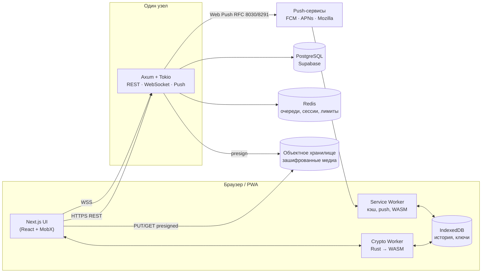
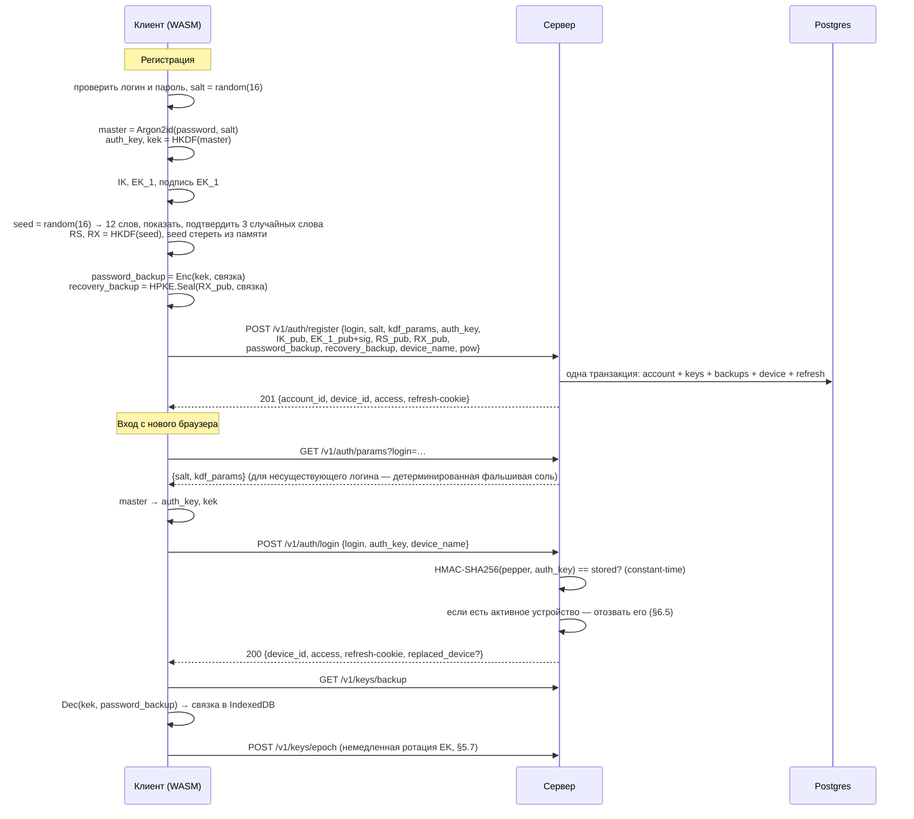
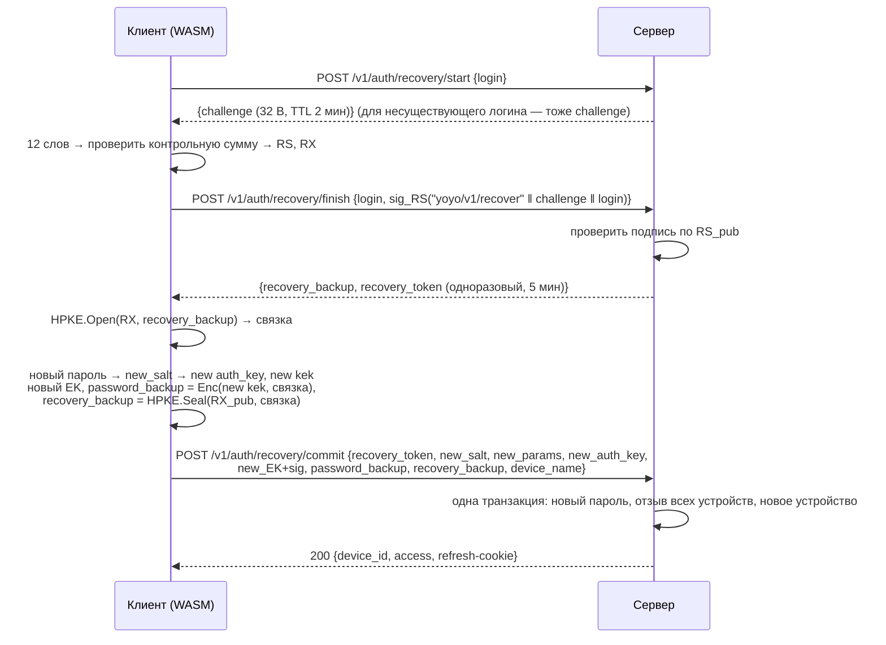
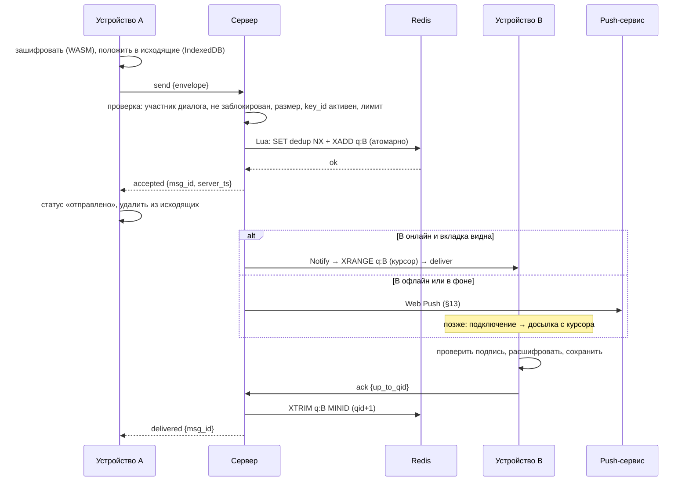

# YoYo Messenger — спецификация сервиса

**Статус:** v0.3. Базовый проект уточнён ответами заказчика (Q1–Q6, Q9, Q11 — [§19](#19-открытые-вопросы)): одно устройство на аккаунт, только личные диалоги, восстановление по seed-фразе, редактирование и удаление сообщений, медиа 30 дней, PoW при регистрации, вход без OPAQUE.
**Объём:** веб-мессенджер (браузер + PWA на мобильных), backend + frontend. Реализация не входит.

---

## 1. Цели и рамки

### Цели

1. Личная переписка один на один в браузере и в PWA на телефоне: текст, изображения, реакции, редактирование и удаление.
2. Сквозное шифрование «без сложности Signal»: сервер хранит и пересылает только шифртекст, но протокол помещается в одну страницу и реализуется одной командой.
3. Доставка в реальном времени по WebSocket; сообщения не теряются, пока получатель офлайн.
4. Уведомления, когда приложение закрыто ([§13](#13-уведомления-при-закрытом-приложении--исследование)).
5. Простая эксплуатация: один сервер на Rust (Axum + Tokio), PostgreSQL (Supabase), Redis.

### Этапы

| Этап | Что входит |
|---|---|
| **v1** (эта спецификация) | Личные диалоги, **одно активное устройство на аккаунт**, история с момента входа, восстановление по seed-фразе |
| **Этап 2** | Группы, несколько устройств одновременно ([§16.1](#161-этап-2-группы-и-несколько-устройств)) |

### Не цели v1

- Двойной храповик (Double Ratchet), одноразовые prekeys, MLS. Почему — [§5.9](#59-чем-это-слабее-signal-и-почему-это-приемлемо).
- Группы и одновременная работа на нескольких устройствах — этап 2.
- Индикатор набора и онлайн-статус / «был в сети». Пользователи всё чаще скрывают эти данные сами, а сервер, который их не собирает, не может их и раскрыть.
- Звонки, статусы, каналы, боты, федерация.
- Скрытие метаданных от сервера (кто с кем, когда). Сервер их видит, это зафиксировано в модели угроз.
- Нативные приложения. Путь к ним описан в §13.6.

### Допущения по нагрузке (уточнить)

| Параметр | v1 | Запас одного узла |
|---|---|---|
| Зарегистрированных аккаунтов | 10 000 | — |
| Одновременных WebSocket | 2 000 | ≥ 20 000 |
| Сообщений в пике | 50/с | ≥ 1 000/с |
| Размер изображения | до 10 МБ после сжатия на клиенте | — |

---

## 2. Требования

### 2.1 Функциональные

| ID | Требование |
|---|---|
| F1 | Регистрация по логину и паролю. Логин — ASCII, от 3 символов ([§6.1](#61-логин)). Пароль — сложный ([§6.2](#62-пароль)). |
| F2 | Вход с любого браузера по логину и паролю. Ключи шифрования восстанавливаются из зашифрованной резервной копии ([§5.4](#54-резервная-копия-ключей)). Вход на новом устройстве завершает сессию на прежнем (одно активное устройство). История на новом устройстве начинается с момента входа, плюс недоставленное из очереди. |
| F3 | Поиск собеседника по точному логину, создание личного диалога. |
| F4 | Текстовые сообщения (до 4 096 символов). |
| F5 | Изображения с превью; на клиенте сжимаются и очищаются от EXIF. |
| F6 | Реакции эмодзи на сообщение: поставить и снять, несколько разных от одного пользователя. |
| F7 | Статусы «отправлено» → «доставлено» → «прочитано». Квитанции о прочтении можно отключить, тогда пользователь не видит и чужих (как в WhatsApp). |
| F8 | Офлайн-очередь: сообщение ждёт получателя до 30 дней. |
| F9 | Push-уведомления при закрытом приложении, с превью или без (настройка). |
| F10 | Сведения об активном устройстве и журнал входов; «выйти отовсюду». |
| F11 | Сверка ключей собеседника (код безопасности / QR) и предупреждение о смене ключа. |
| F12 | Смена пароля без потери ключей и истории. |
| F13 | Редактирование своего текстового сообщения или подписи к изображению в течение 24 ч; у получателя появляется пометка «изменено». |
| F14 | Удаление сообщения: «у себя» — в любое время; «у всех» — своё сообщение в течение 24 ч, на его месте остаётся «Сообщение удалено». |
| F15 | Восстановление доступа по seed-фразе из 12 слов при забытом пароле — без потери ключей, без участия почты и оператора ([§6.6](#66-восстановление-по-seed-фразе)). |

### 2.2 Нефункциональные

| ID | Требование | Цель |
|---|---|---|
| N1 | Задержка доставки онлайн-получателю (accept → deliver) | p95 < 300 мс |
| N2 | Принятое сервером сообщение не теряется | RPO = 0 для `accepted` ([§10.2](#102-redis)) |
| N3 | Повтор отправки не создаёт дубля | идемпотентность по `msg_id` |
| N4 | Сервер не хранит открытый текст сообщений, медиа, реакций и правок | проверяется тестом на дамп БД и Redis |
| N5 | Холодный старт PWA на среднем телефоне | < 2 с до списка чатов из локального кэша |
| N6 | Доступность v1 | 99,5 % в месяц; плановые перезапуски без потери сообщений |
| N7 | Данные в ЕС | регион Supabase и хранилища — ЕС (GDPR) |

---

## 3. Модель угроз

### 3.1 Что сервер знает и чего не знает

| Знает | Не знает |
|---|---|
| Логин, время регистрации, активное устройство, IP | Пароль (получает только производный `auth_key`, [§6.3](#63-регистрация-и-вход)) и seed-фразу (только её публичные ключи) |
| Что было восстановление доступа | Связь сообщений: правка, удаление или реакция и на какое сообщение они ссылаются |
| Кто с кем в диалоге, время и размер (с паддингом) каждого сообщения | Текст, тип сообщения (текст / картинка / реакция / квитанция) |
| Размер зашифрованного медиа-файла | Содержимое, размеры в пикселях, подпись |
| Факт доставки на устройство | Факт прочтения (квитанция зашифрована) |
| Публичные ключи | Приватные ключи; резервная копия зашифрована ключом из пароля |
| Push-endpoint устройства | Содержимое push-уведомления |

### 3.2 Противники

| Противник | Защита |
|---|---|
| Утечка БД / Redis / хранилища медиа | Только шифртексты и публичные ключи. Резервная копия ключей стойка ровно настолько, насколько стоек пароль: Argon2id + требования к паролю. |
| Любопытный оператор сервера | Не читает содержимое. Видит метаданные (§3.1). |
| Злонамеренный сервер подменяет ключ собеседника | TOFU + предупреждение о смене ключа + сверка кода безопасности (F11). |
| Злонамеренный сервер отдаёт изменённый JS | **Не закрыто полностью** — общая проблема веб-E2E. Снижение риска: CSP, SRI, воспроизводимая сборка с публикуемыми хешами, кэш app shell в Service Worker. См. [§12.6](#126-безопасность-клиента). |
| XSS на клиенте | Строгий CSP, Trusted Types, без сторонних скриптов, крипто в отдельном Worker. XSS = компрометация аккаунта, поэтому это главный риск клиента. |
| Перехват трафика | TLS 1.3 + E2E. |
| Подбор пароля онлайн | Лимиты по логину и IP ([§7.6](#76-лимиты)). |
| Украденное устройство | «Выйти отовсюду» с другого браузера (или восстановление по seed-фразе) + ротация эпохального ключа; опционально блокировка паролем. |
| Подбор или кража seed-фразы | 128 бит энтропии — перебор невозможен. Кража фразы равна захвату аккаунта: пользователь хранит её офлайн, о чём ему сказано при регистрации. Каждое восстановление выбрасывает активное устройство и меняет эпохальный ключ, поэтому владелец его заметит. |
| Взлом почты пользователя | Почта не участвует в восстановлении, поэтому её взлом аккаунт не раскрывает (D10). |
| Получатель не выполняет «удалить у всех» | Не закрывается: модифицированный клиент может сохранить сообщение, а push уже мог показать текст. Удаление у всех — вежливость протокола, а не гарантия. Так об этом и сказано в UI. |

### 3.3 Вне рамок v1

Анонимность отправителя (sealed sender), скрытие социального графа, защита от скомпрометированной ОС или браузера, правдоподобное отрицание авторства.

---

## 4. Архитектура



### 4.1 Компоненты

| Компонент | Ответственность |
|---|---|
| **`yoyo-proto`** (Rust crate) | Типы конвертов и фреймов, сериализация (MessagePack), версии протокола. Собирается в нативный код для сервера и в WASM для клиента — один источник истины. |
| **`yoyo-crypto`** (Rust crate → WASM) | Только на клиенте: KDF, генерация и хранение ключей, шифрование сообщений и медиа, подписи, коды безопасности. |
| **Next.js-клиент** | UI, состояние, работа с сетью. С ключами не работает напрямую — только через Crypto Worker. |
| **Service Worker** | Кэш app shell (офлайн-старт), приём Web Push, расшифровка превью через тот же WASM. |
| **Axum-сервер** | Аутентификация, каталог ключей, диалоги и участники, приём и раздача конвертов, presign медиа, отправка Web Push, метрики. |
| **PostgreSQL** | Всё долговечное, кроме очередей сообщений: аккаунты, устройства, ключи, резервные копии ключей, диалоги, push-подписки. |
| **Redis** | Очереди доставки по аккаунтам, дедупликация, access-сессии, лимиты. |
| **Объектное хранилище** | Зашифрованные медиа (Supabase Storage или любой S3). |

### 4.2 Устройство серверного процесса

Один бинарник, модули по доменам:

```
yoyo-server
├── http/        роутер Axum, middleware (trace, лимиты, auth, CORS)
├── auth/        регистрация, вход, токены, смена пароля, восстановление
├── keys/        каталог ключей, резервные копии
├── conv/        диалоги и участники
├── delivery/    приём конвертов, запись в очередь, раздача
├── ws/          жизненный цикл соединения, реестр соединений
├── media/       presign, учёт объектов, чистка
├── push/        подписки, VAPID, отправка, учёт ошибок
├── jobs/        фоновые задачи: TTL очередей, чистка медиа, ротация
└── obs/         метрики, трассировка, health
```

Реестр соединений — `DashMap<DeviceId, ConnHandle>` внутри процесса. `ConnHandle` содержит `tokio::sync::Notify` для пробуждения и канал закрытия. Соединение не хранит сообщений — оно только читает свою очередь в Redis с курсора. Поэтому обрыв, перезапуск сервера или медленный клиент ничего не теряют ([§9](#9-доставка-сообщений)).

---

## 5. Криптография

### 5.1 Принцип

Ключи принадлежат **аккаунту**, а не устройству. В v1 у аккаунта одно активное устройство; новое устройство получает те же ключи из зашифрованной резервной копии (§5.4), поэтому смена браузера не меняет ключей и собеседники не видят предупреждений. Сообщение шифруется один раз ключом содержимого, а этот ключ заворачивается HPKE для получателя. Формат конверта сразу допускает список получателей — это задел для групп и нескольких устройств на этапе 2 (§16.1).

Forward secrecy даётся не храповиком, а **эпохальными ключами**: аккаунт меняет ключ шифрования раз в 7 дней и удаляет старые приватные ключи после окна доставки. Утечка текущих ключей не раскрывает перехваченные шифртексты старше ~5 недель.

### 5.2 Примитивы

| Назначение | Примитив | Реализация (RustCrypto, собирается в `wasm32`) |
|---|---|---|
| KDF из пароля | Argon2id, m = 64 МиБ, t = 3, p = 1, параметры хранятся per-account | `argon2` |
| Разделение ключей | HKDF-SHA-256 | `hkdf`, `sha2` |
| Ключ личности (подписи) | Ed25519 | `ed25519-dalek` |
| Эпохальный ключ (шифрование) | X25519 | `x25519-dalek` |
| Заворачивание ключа содержимого | HPKE base mode, DHKEM(X25519, HKDF-SHA256), HKDF-SHA256, ChaCha20-Poly1305 (RFC 9180) | `hpke` |
| Шифрование содержимого | XChaCha20-Poly1305 | `chacha20poly1305` |
| Шифрование медиа | XChaCha20-Poly1305 в режиме STREAM, блоки по 64 КиБ | `chacha20poly1305::aead::stream` |
| Случайность | `getrandom` → `crypto.getRandomValues` | `getrandom` (feature `js`) |

Никаких своих примитивов. Шифрование и разбор форматов живут в Rust; JavaScript получает только непрозрачные байты и результаты.

### 5.3 Ключи аккаунта

```
password ──Argon2id(salt, params)──► master (32 B)
master ──HKDF("yoyo/v1/auth")──► auth_key  (32 B)  → отправляется на сервер
master ──HKDF("yoyo/v1/kek") ──► kek       (32 B)  → никогда не покидает клиент

identity:  Ed25519 (IK)       — постоянный, меняется только при сбросе аккаунта
epoch:     X25519  (EK_n)     — новый раз в 7 дней, подписан IK

seed (128 бит, 12 слов BIP39) ──HKDF("yoyo/v1/rec-sign")──► RS: Ed25519 — доказывает владение фразой
                              ──HKDF("yoyo/v1/rec-enc") ──► RX: X25519  — на него шифруется копия связки
```

Seed-фраза не хранится ни на устройстве, ни на сервере. Устройство держит только публичный `RX_pub`, сервер — `RS_pub` и `RX_pub`. Подробно — §6.6.

Подпись эпохального ключа:
`sig = Ed25519(IK, "yoyo/v1/epoch" ‖ account_id ‖ key_id ‖ EK_pub ‖ valid_from ‖ valid_until)`.

Отправитель берёт у сервера текущий `EK` собеседника и проверяет подпись закреплённым `IK` (TOFU). Чужой `IK` на месте закреплённого блокирует отправку до подтверждения пользователем (F11).

### 5.4 Резервная копия ключей

Связка ключей — `{IK, EK_n…EK_{n-k}, версия}` — сериализуется, шифруется XChaCha20-Poly1305 на `kek` и хранится на сервере (`key_backups`). Новое устройство:

1. получает соль и параметры KDF;
2. вычисляет `master`, затем `auth_key` и `kek`;
3. входит по `auth_key`;
4. скачивает и расшифровывает связку.

Запись — с оптимистичной блокировкой: `PUT` с `If-Match: <version>`. В v1 одно устройство, поэтому конфликт возможен только в момент смены устройства. На этапе 2 при `412` клиент скачивает свежую версию, сливает и повторяет.

**Две копии связки.** При каждом изменении связки (ротация `EK`, смена пароля) клиент пишет её дважды:

| Копия | Шифрование | Для чего |
|---|---|---|
| `password_backup` | XChaCha20-Poly1305 на `kek` из пароля | Обычный вход на новом устройстве |
| `recovery_backup` | HPKE на `RX_pub` из seed-фразы | Восстановление при забытом пароле (§6.6) |

Для второй копии устройству нужен только публичный ключ, поэтому ни сама фраза, ни её секрет на устройстве не хранятся. Обе копии обновляются одним `PUT`, атомарно.

**Следствие:** забыты и пароль, и seed-фраза — ключи и аккаунт потеряны. Это свойство, а не ошибка: никто, включая оператора, не может открыть аккаунт за пользователя.

### 5.5 Шифрование сообщения

```
cek    = random(32)
nonce  = random(24)
inner  = MessagePack(InnerMessage) + паддинг до корзины 256 / 1 К / 4 К / 16 К / 64 К
header = {v, msg_id, conv_id, sender_account_id, recipients[(account_id, key_id)]}
body   = XChaCha20-Poly1305(cek, nonce, inner, aad = SHA-256(header))

для каждого получателя R (в v1 — один собеседник):
  (enc_R, wcek_R) = HPKE.Seal(EK_R, info = "yoyo/v1/msg" ‖ msg_id ‖ conv_id, aad = SHA-256(header), pt = cek)
```

Копию для себя отправитель не делает: открытый текст своего сообщения у него уже есть локально, а второго устройства в v1 нет. На этапе 2 отправитель добавит себя в `recipients`, и формат при этом не изменится.

`InnerMessage` содержит подпись отправителя:
`sig = Ed25519(IK_sender, "yoyo/v1/msg" ‖ SHA-256(header) ‖ SHA-256(inner без sig))`.

Привязка к `header` не даёт серверу переслать конверт в другой диалог, другим получателям или под другим `msg_id`. Получатель проверяет: подпись → членство отправителя в диалоге по своему локальному состоянию → `msg_id` не встречался.

### 5.6 Медиа

1. Клиент перекодирует изображение через `OffscreenCanvas`: длинная сторона до 2048 px, WebP или JPEG q≈0.82, EXIF удаляется. Отдельно делается превью 32 px (BlurHash или крошечный WebP, ≤ 2 КБ).
2. `media_key = random(32)`, шифрование STREAM блоками по 64 КиБ, `sha256` шифртекста.
3. `POST /v1/media` → `media_id` + presigned PUT с фиксированной `Content-Length`.
4. Загрузка шифртекста напрямую в хранилище.
5. Сообщение типа `image` содержит `{media_id, media_key, sha256, size, mime, w, h, thumb}` и шифруется как обычно.

Получатель скачивает по presigned GET, сверяет `sha256`, расшифровывает в Worker. Сервер видит только размер шифртекста.

### 5.7 Ротация и удаление ключей

| Событие | Действие |
|---|---|
| Прошло 7 дней с `valid_from` текущего `EK` | Активное устройство создаёт `EK_{n+1}`, публикует его и обновляет обе копии связки. |
| `EK` старше 35 дней (TTL очереди 30 дней + запас) | Приватная часть удаляется из обеих копий и с устройства. |
| Вход на новом устройстве | Немедленная ротация `EK` новым устройством. Прежнее устройство больше не может читать новые сообщения, даже если его сессию не успели завершить. |
| Смена пароля | Новые `salt`, `auth_key` и `kek`; `password_backup` перешифровывается; `IK` и `EK` не меняются, собеседники ничего не замечают. |
| Восстановление по seed-фразе | Как смена пароля, плюс ротация `EK` и завершение всех сессий. |
| Перевыпуск seed-фразы (настройки, нужен пароль) | Новые `RS` и `RX`, `recovery_backup` перешифровывается, старая фраза перестаёт работать. |
| Сброс аккаунта | Новый `IK`; собеседники видят предупреждение о смене ключа. |

### 5.8 Код безопасности

`safety = base10(SHA-512("yoyo/v1/safety" ‖ min(IK_a, IK_b) ‖ max(IK_a, IK_b))[..30])` — 60 цифр группами по 5, плюс QR. Совпадение у обоих = сервер не подменял ключи.

### 5.9 Чем это слабее Signal и почему это приемлемо

| Свойство | Signal | YoYo v1 |
|---|---|---|
| Forward secrecy | Каждое сообщение (храповик) | Окно ~5 недель (эпохальные ключи) |
| Восстановление после компрометации | Через несколько сообщений | Со следующей ротацией `EK` (≤ 7 дней), но **только если злоумышленник не знает ни пароль, ни seed-фразу** — связка ключей лежит на сервере |
| Ключи устройств | Отдельные на каждое устройство | Общие на аккаунт (в v1 устройство и так одно) |
| Асинхронный старт сессии | X3DH / PQXDH + одноразовые prekeys | Не нужен: HPKE на подписанный эпохальный ключ |
| Состояние сессии на клиенте | Есть, рассинхронизация ломает расшифровку | Нет — каждое сообщение расшифровывается независимо |

Главный выигрыш — отсутствие состояния сессии. Нет класса ошибок «сессия рассинхронизировалась, сообщения не расшифровываются». Вход с нового браузера мгновенно даёт доступ к ключам, а на этапе 2 не понадобится координация устройств. Цена — слабее FS/PCS и общая судьба устройств аккаунта. Для веб-мессенджера, у которого граница доверия и так проходит через JS, который отдаёт сервер (§3.2), это соразмерный компромисс. Путь к MLS оставлен: поле `v` в конверте и отдельный модуль `yoyo-crypto`.

---

## 6. Аккаунты и аутентификация

### 6.1 Логин

- Только ASCII: `^[a-z0-9][a-z0-9._-]{2,31}$` после приведения к нижнему регистру. 3–32 символа.
- Уникальность без учёта регистра (`citext`). Отображается в том виде, в каком ввели.
- Пробелы, `@`, управляющие символы и Unicode запрещены. Это исключает гомоглифы и конфликты с упоминаниями.
- Зарезервированы: `admin`, `support`, `yoyo`, `system`, `root`, `null` и т.п.

> Требование «минимум 3 символа ASCII» сужено до безопасного подмножества. Если нужна вся печатная ASCII — вопрос Q7.

### 6.2 Пароль

- 12–128 символов. Оценка zxcvbn ≥ 3 из 4, с учётом логина как словарного слова.
- Опционально проверка по утечкам HIBP (k-анонимность, отправляется 5 символов SHA-1) — вопрос Q8.
- **Сервер пароль не видит, поэтому сложность проверяет только клиент.** Модифицированный клиент может поставить слабый пароль, но навредит этим только себе. Это записано явно, чтобы никто не считал серверную проверку гарантией.

### 6.3 Регистрация и вход



**Замена устройства.** До проверки пароля сервер не раскрывает, есть ли у логина активное устройство. Поэтому предупреждение показывается после ввода пароля, отдельным шагом:

1. `login` с `confirm_replace: false` → `409 {active_device: "Chrome · macOS", last_seen_at}`;
2. клиент показывает: «Вход здесь завершит сеанс на Chrome · macOS. Переписка с того устройства сюда не перенесётся»;
3. пользователь подтверждает → повтор с `confirm_replace: true`.

**Хранение на сервере:** `auth_hash = HMAC-SHA256(pepper, auth_key)`. Медленный хеш на сервере не нужен: `auth_key` имеет 256 бит энтропии, а дорогой Argon2id уже выполнен на клиенте. Злоумышленнику с утёкшей БД всё равно придётся считать Argon2id на каждую попытку пароля. Сервер при этом не тратит 64 МиБ памяти на каждую попытку входа, и флуд логинами его не положит. `pepper` лежит в секретах, а не в БД.

**Перечисление логинов:** `/auth/params` для несуществующего логина отвечает `salt = HMAC(secret, login)[..16]` и параметрами по умолчанию — ответ неотличим. Регистрация неизбежно раскрывает занятость логина; это прикрыто лимитами.

### 6.4 Токены и сессии

| Токен | Формат | Срок | Где лежит на клиенте |
|---|---|---|---|
| access | 256 бит случайных, на сервере — `sess:{sha256}` в Redis | 15 мин | в памяти Worker |
| refresh | 256 бит случайных, в Postgres — хеш, ротация при каждом использовании, повторное использование отзывает всю цепочку | 60 дней скользящий | cookie `__Host-yoyo_rt`, `HttpOnly; Secure; SameSite=Strict; Path=/v1/auth` |
| push-fetch | 256 бит случайных, право только на чтение своей очереди без подтверждения | 60 дней, отзывается вместе с устройством | IndexedDB (нужен Service Worker) |

Непрозрачные токены вместо JWT: на одном сервере проверка — один запрос в Redis, а отзыв мгновенный. CSRF: `SameSite=Strict` и обязательный заголовок `X-Yoyo-Client` на изменяющих запросах.

### 6.5 Устройство

Устройство — это пара «браузер + профиль» или установленная PWA. Создаётся при входе, имеет имя (`Chrome · macOS`) и push-подписку. **В v1 у аккаунта ровно одно активное устройство**: уникальный частичный индекс `devices (account_id) where revoked_at is null`.

Вход на новом устройстве в одной транзакции:

1. помечает прежнее устройство отозванным, удаляет его refresh-цепочку, access-сессии и push-подписку;
2. создаёт новое устройство.

После транзакции прежний WebSocket закрывается кодом `4003`, а новое устройство меняет `EK` (§5.7).

Очередь доставки принадлежит **аккаунту**, а не устройству (`q:{account}`, §10.2). Всё, что прежнее устройство не успело подтвердить, получит новое. Уже доставленное и подтверждённое осталось только на прежнем устройстве — это и есть «история с момента входа» (Q2).

«Выйти отовсюду» (F10) отзывает активное устройство, не создавая нового. Журнал входов (время, имя устройства, усечённый IP) хранится 90 дней.

### 6.6 Восстановление по seed-фразе

**Зачем фраза, а не почта.** Сброс по почте означает, что аккаунт открывает тот, у кого есть почта: её владелец, взломщик почты или оператор сервера. К тому же ключей сброс не вернёт: сервер их не знает. Пришлось бы выдавать новые, а собеседники увидели бы смену ключа. Seed-фраза восстанавливает и доступ, и ключи, а ни почта, ни оператор в этом не участвуют (D10).

**Регистрация.**
- Клиент генерирует 128 бит энтропии и показывает их как 12 слов BIP39 (английский словарь, встроенная контрольная сумма ловит опечатки).
- Чтобы продолжить, пользователь вводит 3 случайных слова из 12. Шаг обязательный, но фразу можно показать ещё раз, пока регистрация не завершена.
- Предупреждение: «Фраза — единственный способ вернуть аккаунт без пароля. Кто знает фразу, тот владеет аккаунтом. Запишите её на бумаге, не храните в облаке и скриншотах».
- Из фразы выводятся `RS` (Ed25519) и `RX` (X25519) (§5.3). На сервер уходят только `RS_pub` и `RX_pub`, сама фраза стирается из памяти Worker.

**Восстановление.**



Подробности:
- `finish` выдаёт `recovery_backup` только после проверки подписи. `commit` принимает только `recovery_token` от успешного `finish`; токен одноразовый и живёт 5 минут.
- Лимит: 5 попыток в час на логин и 20 в сутки на IP. Перебор 128 бит невозможен, лимит защищает от нагрузки.
- Ключи `IK` не меняются, поэтому собеседники не видят предупреждения. Они видят только обычную ротацию `EK`.
- После восстановления фраза остаётся той же. Пользователю предлагается перевыпустить её (§5.7), если есть подозрение, что фразу видели.
- Событие восстановления пишется в журнал входов и показывается при следующем открытии на любом устройстве: «Доступ восстановлен по seed-фразе <дата>».

**Оператор не может восстановить аккаунт ни при каких условиях.** Это говорится пользователю при регистрации и в справке.

### 6.7 Защита регистрации: proof-of-work

Капча потребовала бы стороннего скрипта (это противоречит CSP, §12.6) и передачи данных пользователя третьей стороне. Инвайты отсекают обычных пользователей. Поэтому регистрация стоит вычислений, а не данных (Q9).

1. `GET /v1/auth/pow` → `{challenge, difficulty, expires_at}`:
   - `challenge` = 16 случайных байт ‖ `expires_at` ‖ HMAC сервера по ним, живёт 5 минут;
   - `difficulty` — число нулевых старших бит.
2. Клиент в Worker (WASM) ищет `nonce`, при котором у `SHA-256("yoyo/v1/pow" ‖ challenge ‖ login ‖ nonce)` не меньше `difficulty` нулевых бит. Пока идёт поиск, UI показывает экран seed-фразы, поэтому пользователь ожидания почти не замечает.
3. `register` несёт `pow: {challenge, nonce}`. Сервер проверяет HMAC, срок и число нулей, то есть делает один хеш. Затем `SET pow:{challenge} NX EX 300`: каждый challenge одноразовый.

| Параметр | Значение |
|---|---|
| Базовая сложность | 20 бит: ~1 млн хешей, около 1 с на телефоне среднего уровня в WASM |
| Адаптация | При > 50 регистраций в час на сервис сложность растёт на 1 бит за каждое удвоение, максимум 24 бита (~16 с), и снижается обратно через час спокойствия |
| Привязка к логину | `login` входит в хеш, поэтому одно решение нельзя потратить на много аккаунтов |

PoW замедляет массовую регистрацию с одной машины, но не останавливает ботнет или атакующего с GPU: SHA-256 на GPU в тысячи раз быстрее, чем в браузере. Он дополняет лимит по IP (§7.6), а не заменяет его. Если боты всё же пойдут, следующий шаг — memory-hard PoW на том же Argon2id (выравнивает GPU и телефон), затем инвайты. Это решение отдельного ADR.

---

## 7. Протокол WebSocket

### 7.1 Соединение

- `wss://api.<домен>/v1/ws`, проверка `Origin` по allowlist.
- Токен **не** передаётся в URL (он попал бы в логи прокси). Первый фрейм клиента — `auth`, таймаут 5 с.
- Бинарные фреймы, MessagePack, схема из `yoyo-proto`. Максимальный фрейм — 256 КиБ.
- Heartbeat: клиент шлёт `ping` раз в 25 с (меньше типичного idle-таймаута прокси в 60 с); сервер закрывает соединение после 60 с тишины.
- Второе соединение того же `device_id` закрывает первое кодом `4009`.

### 7.2 Фреймы

Общая обёртка: `{t: <тип>, id?: <corr_id>, ...}`.

| Направление | Тип | Поля | Назначение |
|---|---|---|---|
| C→S | `auth` | `access, device_id, cursor, proto_v` | Аутентификация и курсор возобновления |
| S→C | `ready` | `server_time, cursor, min_proto_v` | Соединение готово, начинается досылка |
| C→S | `send` | `envelope` | Отправка конверта |
| S→C | `accepted` | `msg_id, server_ts` | Конверт сохранён во всех очередях (идемпотентно) |
| S→C | `rejected` | `msg_id, code, retry_after?` | `not_member`, `too_large`, `rate_limited`, `stale_key`, `bad_envelope` |
| S→C | `deliver` | `qid, server_ts, sender_device_id, envelope` | Доставка из очереди; `qid` — ID записи в Redis Stream |
| C→S | `ack` | `up_to_qid` | Кумулятивное подтверждение: всё до `qid` обработано и сохранено локально |
| S→C | `delivered` | `msg_id` | Квитанция «доставлено»: устройство получателя подтвердило сообщение |
| S→C | `event` | `kind, ...` | `key_changed`, `queue_expired`, `recovered` |
| C→S | `focus` | `visible: bool` | Видна ли вкладка. Нужно только серверу для решения о push (§13.3), собеседнику не передаётся и нигде не хранится |
| C↔S | `ping` / `pong` | `ts` | Heartbeat и оценка RTT |

Квитанция «прочитано» — это не фрейм протокола, а зашифрованное сообщение типа `Read` (§11). Сервер о прочтении не знает.

Индикатора набора и онлайн-статуса в протоколе нет (§1). Это не настройка «скрыть», а отсутствие данных: сервер их не получает.

### 7.3 Жизненный цикл клиента

```
CONNECTING → AUTHENTICATING → SYNCING (досылка с cursor) → LIVE
     ↑                                                      │
     └──── backoff 0.5 с → 30 с, full jitter ◄── обрыв ─────┘
```

Неподтверждённые `send` лежат в исходящей очереди в IndexedDB и переотправляются после `ready` с тем же `msg_id`. Сервер ответит тем же `accepted`, дубля не будет.

### 7.4 Коды закрытия

| Код | Смысл | Действие клиента |
|---|---|---|
| 1000 | Нормальное закрытие | — |
| 1012 | Сервер перезапускается | Переподключиться с jitter |
| 4001 | Неверный или просроченный access | Refresh → переподключиться |
| 4002 | Нет `auth` за 5 с | Переподключиться |
| 4003 | Устройство отозвано (вход на другом устройстве, «выйти отовсюду», восстановление) | Показать причину, стереть локальные данные, на экран входа |
| 4008 | Медленный потребитель (переполнен буфер) | Переподключиться; досылка с курсора |
| 4009 | Заменено другим соединением этого устройства | Не переподключаться автоматически |
| 4010 | Версия протокола ниже `min_proto_v` | Обновить приложение |

### 7.5 Обратное давление

Отправка клиенту идёт через ограниченный канал (256 фреймов). Если канал полон, соединение закрывается кодом `4008`. Ничего не теряется: очередь в Redis, клиент продолжит с курсора. Сервер не держит в памяти неограниченных буферов ни для одного клиента.

### 7.6 Лимиты

| Действие | Лимит | Ключ |
|---|---|---|
| `send` | 30 за 10 с, всплеск 60 | устройство |
| `send` с изображением | 10 в минуту | аккаунт |
| Вход | 5 в минуту, 20 в час | логин + IP, отдельно IP |
| Регистрация | 3 в час | IP, плюс proof-of-work (§6.7) |
| Восстановление | 5 в час, 20 в сутки | логин, IP |
| `/auth/params` | 30 в минуту | IP |
| `POST /v1/media` | 100 МБ в час | аккаунт |

Реализация — token bucket в Redis (Lua-скрипт, одна операция на проверку).

---

## 8. REST API

Все пути начинаются с `/v1`. Тела — JSON, бинарные поля в base64url. Ошибки — RFC 9457 (`application/problem+json`) с машинным `code`.

| Метод и путь | Назначение |
|---|---|
| `GET /auth/params?login=` | Соль и параметры KDF |
| `GET /auth/pow` | Задача proof-of-work для регистрации (§6.7) |
| `POST /auth/register` | Регистрация (§6.3) |
| `POST /auth/login` | Вход, замена активного устройства (`confirm_replace`, §6.3) |
| `POST /auth/refresh` | Новый access, ротация refresh |
| `POST /auth/logout` | Выход на текущем устройстве |
| `POST /auth/logout-all` | «Выйти отовсюду» (F10) |
| `POST /auth/password` | Смена пароля: `{old_auth_key, new_salt, new_params, new_auth_key, new_backup, backup_version}` — атомарно |
| `POST /auth/recovery/start` · `/finish` · `/commit` | Восстановление по seed-фразе (§6.6) |
| `POST /auth/recovery/rotate` | Перевыпуск seed-фразы: `{auth_key, RS_pub, RX_pub, recovery_backup}` |
| `GET /auth/history` | Журнал входов и восстановлений, 90 дней |
| `GET /keys/backup` · `PUT /keys/backup` | Обе копии связки (`password_backup`, `recovery_backup`), `ETag` / `If-Match` |
| `POST /keys/epoch` | Публикация нового `EK` |
| `GET /accounts/by-login/{login}` | `account_id`, `IK_pub`, текущий `EK` — только точное совпадение |
| `GET /accounts/{id}/keys` | `IK_pub` и активные `EK` |
| `GET /conversations` · `POST /conversations` | Список диалогов; создание личного диалога (идемпотентно по паре аккаунтов) |
| `GET /conversations/{id}` | Собеседник и его текущий `key_id` |
| `POST /media` | `{size}` → `{media_id, upload_url, expires_at}` |
| `GET /media/{id}` | 302 на presigned GET (60 с) |
| `DELETE /media/{id}` | Только владелец: удалить объект (при «удалить у всех», §11) |
| `POST /push/subscriptions` · `DELETE /push/subscriptions/current` | Web Push подписка устройства |
| `GET /push/peek?after=` | Только для push-fetch токена: конверты очереди без подтверждения (§13) |
| `POST /blocks` · `DELETE /blocks/{account_id}` | Блокировка: сервер не принимает конверты от заблокированного |
| `GET /ws` | Upgrade в WebSocket |
| `GET /healthz` · `GET /readyz` | Liveness / readiness (БД, Redis) |
| `GET /metrics` | Prometheus, только на внутреннем порту |

---

## 9. Доставка сообщений

### 9.1 Поток



### 9.2 Гарантии

| Свойство | Как обеспечено |
|---|---|
| **Атомарность приёма** | Дедупликация и `XADD` — один Lua-скрипт: либо конверт записан и помечен, либо нет ни того, ни другого. Скрипт уже принимает список очередей — на этапе 2 то же самое даёт «у всех получателей или ни у кого». `accepted` отправляется только после успеха. |
| **Идемпотентность** | `msg_id` = UUIDv7 от клиента. `dedup:{sender_account}:{msg_id}` → `server_ts`, `SET NX EX 7d`. Повтор возвращает исходный `accepted` и ничего не пишет. |
| **Доставка** | At-least-once от сервера к устройству, удаление только после `ack`. Клиент отбрасывает повторный `msg_id` → для пользователя сообщение приходит ровно один раз. |
| **Порядок** | `server_ts` присваивается один раз при приёме. UI сортирует по `(server_ts, msg_id)`. Внутри очереди порядок сохраняется, поэтому правка, удаление и реакция не обгоняют своё сообщение. |
| **Долговечность** | `accepted` = записано в Redis с AOF `appendfsync always` (§10.2). |
| **TTL** | Записи старше 30 дней удаляются (`XTRIM MINID` по времени). Аккаунт, не выходивший на связь 30 дней, получает при подключении `event{kind: queue_expired}`, и клиент показывает, что часть сообщений утрачена. Молча сообщения не пропадают. |

### 9.3 Очередь на аккаунт

В v1 у аккаунта одно устройство, поэтому очередь принадлежит аккаунту: `q:{account}`. Это даёт замену устройства без особых случаев: новое устройство читает ту же очередь с начала, и недоставленное прежнему достаётся ему (§6.5). Курсор хранит клиент, а не сервер. Подтверждённое удаляется из очереди, поэтому курсор нового устройства — просто «с начала».

На этапе 2 очередь станет `q:{device}`, а приём — раскладкой копий по устройствам (§16.1).

### 9.4 Отказы

| Ситуация | Поведение |
|---|---|
| Обрыв до `accepted` | Клиент переотправит тот же `msg_id` → дедупликация. |
| Обрыв после `deliver`, до `ack` | Повторная доставка с курсора → дубль отбрасывает клиент. |
| Замена устройства посреди доставки | Прежнее устройство закрыто `4003` до того, как новое получит `ready`; его неподтверждённый `ack` сервер больше не примет. Новое устройство получит эти записи заново. |
| Падение сервера | Состояние в Redis и Postgres; клиенты переподключаются с jitter и продолжают с курсора. |
| Redis недоступен | `send` → `rejected{code: unavailable, retry_after}`. Сообщения остаются в исходящих на клиенте. Ничего не подтверждается без записи. `/readyz` = 503. |
| Postgres недоступен | Работают отправка и доставка в существующих диалогах (членство кэшируется в Redis). Не работают вход, регистрация и создание диалогов. |
| `stale_key` (получатель сменил `EK`) | Клиент обновляет ключи собеседника и перешифровывает с новым `msg_id`. |

---

## 10. Хранилища

### 10.1 PostgreSQL (Supabase)

Отдельная схема `app`, не открытая через Supabase Data API (PostgREST) — к базе ходит только сервер. Подключение напрямую или через Supavisor в **session mode**: `sqlx` использует подготовленные выражения, а transaction mode с ними несовместим. Миграции — `sqlx migrate`, только вперёд, каждая проверяется в CI на копии схемы.

```sql
create table app.accounts (
  id            uuid primary key,              -- UUIDv7
  login         citext not null unique,
  login_display text   not null,
  auth_hash     bytea  not null,               -- HMAC-SHA256(pepper, auth_key)
  kdf_salt      bytea  not null,
  kdf_params    jsonb  not null,               -- {alg:"argon2id", m:65536, t:3, p:1}
  identity_pub  bytea  not null,               -- Ed25519
  recovery_sign_pub bytea not null,            -- RS_pub, Ed25519 из seed-фразы
  recovery_enc_pub  bytea not null,            -- RX_pub, X25519 из seed-фразы
  status        text   not null default 'active',  -- active | locked | deleted
  created_at    timestamptz not null default now()
);

create table app.epoch_keys (
  account_id  uuid not null references app.accounts on delete cascade,
  key_id      int  not null,
  x25519_pub  bytea not null,
  signature   bytea not null,
  valid_from  timestamptz not null,
  valid_until timestamptz not null,
  primary key (account_id, key_id)
);

create table app.key_backups (
  account_id  uuid primary key references app.accounts on delete cascade,
  version          bigint not null,
  password_backup  bytea  not null,            -- XChaCha20-Poly1305(kek, связка)
  recovery_backup  bytea  not null,            -- HPKE(RX_pub, связка)
  updated_at       timestamptz not null default now()
);

create table app.devices (
  id           uuid primary key,
  account_id   uuid not null references app.accounts on delete cascade,
  name         text not null,
  created_at   timestamptz not null default now(),
  last_seen_at timestamptz,
  revoked_at   timestamptz,
  revoke_reason text                           -- replaced | logout | logout_all | recovered
);
-- v1: одно активное устройство на аккаунт. На этапе 2 индекс снимается.
create unique index devices_one_active on app.devices (account_id) where revoked_at is null;

create table app.auth_events (
  id          bigint generated always as identity primary key,
  account_id  uuid not null references app.accounts on delete cascade,
  kind        text not null,                   -- login | login_failed | recovered | password_changed | seed_rotated
  device_name text,
  ip_prefix   inet,                            -- усечённый /24 или /48
  at          timestamptz not null default now()   -- чистка старше 90 дней
);

create table app.refresh_tokens (
  token_hash  bytea primary key,
  device_id   uuid not null references app.devices on delete cascade,
  family_id   uuid not null,                   -- повторное использование отзывает семейство
  expires_at  timestamptz not null,
  used_at     timestamptz
);

create table app.conversations (
  id          uuid primary key,
  kind        text not null check (kind in ('direct')),  -- 'group' добавится на этапе 2
  direct_key  text unique,                     -- 'min(a)|max(b)'
  meta_enc    bytea,                           -- задел: имя и аватар группы, зашифрованы
  created_at  timestamptz not null default now()
);

create table app.conversation_members (
  conversation_id uuid not null references app.conversations on delete cascade,
  account_id      uuid not null references app.accounts on delete cascade,
  role            text not null default 'member',
  joined_at       timestamptz not null default now(),
  left_at         timestamptz,
  primary key (conversation_id, account_id)
);

create table app.push_subscriptions (
  device_id   uuid primary key references app.devices on delete cascade,
  endpoint    text  not null,
  p256dh      bytea not null,
  auth        bytea not null,
  fail_count  int   not null default 0,
  created_at  timestamptz not null default now()
);

create table app.media_objects (
  id          uuid primary key,
  owner_id    uuid not null references app.accounts on delete cascade,
  size        bigint not null,
  status      text not null default 'pending',  -- pending | uploaded
  created_at  timestamptz not null default now(),
  expires_at  timestamptz not null
);

create table app.blocks (
  account_id  uuid not null references app.accounts on delete cascade,
  blocked_id  uuid not null references app.accounts on delete cascade,
  primary key (account_id, blocked_id)
);
```

Сообщений, реакций и квитанций в Postgres нет.

### 10.2 Redis

| Ключ | Тип | Содержимое | TTL |
|---|---|---|---|
| `q:{account}` | Stream | `{env, ts, from, silent}` — очередь доставки (§9.3) | 30 дней по `MINID` |
| `rec:{token}` | String | `account_id` после успешного `recovery/finish` | 5 мин |
| `pow:{challenge}` | String | использованный challenge proof-of-work | 5 мин |
| `pow:rate` | String | счётчик регистраций за час для адаптивной сложности | 1 ч |
| `recch:{login}` | String | challenge восстановления | 2 мин |
| `dedup:{account}:{msg_id}` | String | `server_ts` | 7 дней |
| `sess:{sha256(access)}` | Hash | `account_id, device_id` | 15 мин |
| `pushfetch:{sha256}` | String | `device_id` | 60 дней |
| `dev:{account}` | String | активный `device_id` (кэш) | без TTL, инвалидация при входе |
| `members:{conv}` | Set | `account_id` (кэш) | без TTL, инвалидация |
| `rl:{scope}:{key}` | Hash | token bucket | авто |
| `focus:{device}` | String | `visible` / `hidden` — только для решения о push | 60 с, продлевается heartbeat |

**Долговечность.** `appendonly yes`, `appendfsync always`. Для мессенджера молчаливая потеря принятого сообщения — худший отказ: ошибки нет, сообщения нет. При 50–1 000 записях в секунду на SSD fsync на каждую запись укладывается в бюджет. Переход на `everysec` (окно потери до 1 с) — только по результатам замера и с записью в ADR. Ограничение v1: единственный экземпляр Redis — единая точка отказа. При его потере теряются неподтверждённые очереди. Резервирование — §16.

`maxmemory-policy noeviction`: очередь не должна вытесняться молча. При нехватке памяти запись падает, и `send` получает `rejected`.

### 10.3 Объектное хранилище

- Supabase Storage (S3 API) или любой S3, бакет приватный, регион ЕС.
- Ключ объекта — `m/{media_id}`, presigned PUT с точной `Content-Length` и сроком 10 мин.
- После загрузки клиент отправляет сообщение. Объекты в статусе `pending` старше часа удаляются фоновой задачей.
- Срок хранения — 30 дней, как у очереди (Q4, подтверждено). Скачивать медиа после истечения срока некому, если история хранится только на клиентах.
- Доступ — по `media_id` (128 бит случайных) для любого аутентифицированного пользователя. Сервер не может проверить, что медиа относится к диалогу: связь лежит внутри шифртекста. Утечка `media_id` без `media_key` ничего не раскрывает.

---

## 11. Типы сообщений

`InnerMessage` (MessagePack, внутри шифртекста):

```rust
struct InnerMessage {
    v: u8,
    msg_id: Uuid,
    conv_id: Uuid,
    sent_at: i64,          // часы отправителя, только для отображения
    body: Body,
    sig: [u8; 64],         // §5.5
}

enum Body {
    Text     { text: String },                                   // ≤ 4096 символов
    Image    { media_id: Uuid, key: [u8;32], sha256: [u8;32],
               size: u64, mime: String, w: u16, h: u16,
               thumb: Vec<u8>, caption: Option<String> },
    Reaction { target: Uuid, emoji: String, op: ReactionOp },    // Add | Remove
    Edit     { target: Uuid, text: String },                     // новый текст или подпись
    Delete   { target: Uuid },                                   // «удалить у всех»
    Read     { up_to: Uuid },                                    // квитанция «прочитано»
    System   { kind: SystemKind },                               // смена ключа и т.п.
}
```

Для сервера все типы неотличимы: одинаковый конверт, корзины паддинга (§5.5). Единственная видимая подсказка — флаг `silent` (§13.3).

**Общее правило для ссылок.** `Reaction`, `Edit` и `Delete` ссылаются на `target`. Получатель применяет операцию только если:
1. `target` есть в его истории;
2. для `Edit` и `Delete` — отправитель операции совпадает с отправителем `target`;
3. для `Edit` и `Delete` — `server_ts(операции) − server_ts(target) ≤ 24 ч`.

Порядок в очереди сохраняется (§9.2), поэтому операция не может прийти раньше своего сообщения. Если `target` неизвестен (сообщение было подтверждено прежним устройством до замены), операция отбрасывается.

**Реакции.** Состояние: `(target, sender, emoji) → add/remove`, побеждает последняя операция по `(server_ts, msg_id)`. Можно поставить несколько разных эмодзи на одно сообщение. `emoji` проверяется по списку Unicode emoji, длина — до 32 байт.

**Редактирование (F13).**
- Можно править `Text` и подпись `Image`. Само изображение заменить нельзя: для этого удаляют и отправляют заново.
- Лента показывает последнюю версию по `(server_ts, msg_id)` и пометку «изменено». Предыдущие версии не показываются и не хранятся, кроме исходного `server_ts` для сортировки.
- Правка не меняет место сообщения в ленте и не создаёт уведомления (`silent`).
- Окно в 24 ч — константа протокола: получатель проверяет её сам, поэтому изменить окно позже можно только с новой версией клиента.

**Удаление (F14).**
- **«Удалить у меня»** — локальная операция, по сети ничего не уходит. Работает для любых сообщений в любое время.
- **«Удалить у всех»** — сообщение `Delete{target}`. Отправитель и получатель заменяют содержимое на «Сообщение удалено», удаляют реакции, правки и кэш медиа. Для изображения отправитель ещё вызывает `DELETE /v1/media/{id}`.
- Если к этому моменту было показано push-уведомление с текстом, клиент закроет его через `registration.getNotifications({tag})`, но только при следующем запуске приложения. `Delete` идёт с `silent`, а будить Service Worker ради закрытия уведомления нельзя: на каждый push обязано появиться новое уведомление (§13.1).
- В UI честно сказано: «Сообщение будет удалено у собеседника, если его приложение это поддерживает».

**Прочитано.** `Read{up_to}` отправляется собеседнику. Отключённые квитанции (F7) означают, что `Read` не отправляется, а входящие `Read` не показываются.

Версионирование: неизвестный `Body` показывается как «Сообщение не поддерживается, обновите приложение» и не ломает ленту.

---

## 12. Клиент

### 12.1 Стек

| Слой | Выбор | Почему |
|---|---|---|
| Фреймворк | Next.js (App Router), `output: 'export'` | Статическая сборка: сервер не может отрендерить E2E-данные, SSR не нужен. Раздача с CDN, неизменяемые хеши файлов для проверки сборки. |
| UI | React + TypeScript | — |
| Состояние | MobX | Наблюдаемые сторы поверх событий из Worker; хорошо подходит для потока сообщений и реакций. |
| Крипто и протокол | Rust → WASM (`wasm-bindgen`, `wasm-pack`) в Dedicated Worker | Ключи не попадают в основной поток; тяжёлый Argon2id не блокирует UI. |
| Хранилище | IndexedDB (через `idb`) | История, исходящие, связка ключей, кэш медиа. |
| Сеть | Нативный `WebSocket` в Worker | Одна точка, где живёт соединение и курсор. |
| PWA | Web App Manifest + Service Worker (Workbox или свой) | Офлайн-старт, установка, push. |

### 12.2 Потоки клиента

```
Main thread (React/MobX) ⇄ postMessage ⇄ Crypto+Net Worker (WASM, WebSocket, IndexedDB)
Service Worker (push, кэш) ── читает IndexedDB, грузит тот же WASM
```

Основной поток получает только расшифрованные представления сообщений для отображения. Ключи, токены и разбор конвертов — в Worker.

### 12.3 Локальные данные

| Хранилище | Содержимое | Защита |
|---|---|---|
| `keys` | Связка ключей | Зашифрована локальным `vault_key` — WebCrypto AES-GCM, **неизвлекаемый** ключ в IndexedDB |
| `messages` | История по диалогам, индекс `(conv_id, server_ts)` | Зашифрована тем же `vault_key` |
| `outbox` | Неподтверждённые конверты | — (уже шифртекст) |
| `contacts` | `account_id`, логин, закреплённый `IK`, статус сверки | `vault_key` |
| `media_cache` | Расшифрованные изображения | `vault_key`, LRU 200 МБ |

Неизвлекаемый `vault_key` защищает от копирования файлов профиля на другую машину, но не от кода, исполняющегося в этом же origin. Опционально — «блокировка паролем»: `vault_key` заворачивается в `kek`, и без пароля приложение не откроется.

### 12.4 Экраны

1. Регистрация: логин и пароль с индикатором силы → seed-фраза (12 слов, подтверждение трёх) → готово.
2. Вход: логин и пароль → подтверждение замены устройства, если оно есть (§6.3). Ссылка «Забыли пароль?» ведёт к восстановлению.
3. Восстановление: логин → 12 слов (автодополнение по словарю BIP39, проверка контрольной суммы до отправки) → новый пароль.
4. Список диалогов (последнее сообщение, непрочитанные, поиск по логину).
5. Диалог: лента с виртуализацией, отправка текста и изображения, статусы доставки. По долгому нажатию или наведению — реакции и меню «Изменить / Удалить у меня / Удалить у всех».
6. Профиль собеседника (код безопасности, QR, блокировка).
7. Настройки: устройство и журнал входов, «выйти отовсюду», смена пароля, перевыпуск seed-фразы, уведомления и превью, квитанции о прочтении, блокировка паролем, выход.

### 12.5 Офлайн

App shell из кэша Service Worker, история из IndexedDB. Отправка в офлайне кладёт сообщение в `outbox` со статусом «ожидает сети», а при подключении переотправляет его с тем же `msg_id`.

### 12.6 Безопасность клиента

- CSP: `default-src 'self'; script-src 'self' 'wasm-unsafe-eval'; connect-src 'self' wss://api.<домен> https://<s3>; img-src 'self' blob: data:; object-src 'none'; base-uri 'none'; frame-ancestors 'none'; require-trusted-types-for 'script'`.
- Никаких сторонних скриптов, аналитики и шрифтов с чужих доменов.
- Пользовательский текст рендерится только как текст: Markdown-парсер со строгим allowlist, без `dangerouslySetInnerHTML`.
- Воспроизводимая сборка фронтенда. Хеши файлов публикуются в репозитории и в релизе, чтобы любой мог проверить, что ему отдали ту же сборку. Опционально расширение-верификатор по примеру WhatsApp Code Verify.

---

## 13. Уведомления при закрытом приложении — исследование

### 13.1 Что умеет платформа (на ноябрь 2026)

| Платформа | Web Push | Особенности |
|---|---|---|
| Chrome, Edge, Firefox — десктоп и Android | Да | Push работает при закрытой вкладке, пока жив браузер. Push-сервисы: FCM (Chrome, Edge — через WNS), Mozilla autopush. |
| Safari macOS | Да (с Safari 16) | APNs. |
| iOS / iPadOS | Да (с 16.4), **только для PWA, добавленной на экран «Домой»** | Разрешение запрашивается только по жесту пользователя внутри установленной PWA. В обычной вкладке Safari push недоступен. |

Общие правила:
- `userVisibleOnly: true` обязателен: на каждый push нужно показать уведомление. Chrome иначе показывает своё «сайт обновлён в фоне», Safari может отозвать подписку.
- Полезная нагрузка — до 4 096 байт, шифруется для браузера по RFC 8291. Push-сервис (Google, Apple, Mozilla) её не читает, но видит время, размер и endpoint.
- Аутентификация сервера перед push-сервисом — VAPID (RFC 8292), ключ P-256.
- Заголовки RFC 8030: `Urgency: high` для сообщений, `Topic` для схлопывания, `TTL`.

### 13.2 Варианты

| Вариант | Как работает | Плюсы | Минусы |
|---|---|---|---|
| **A. Пустой push** | Push без нагрузки → SW идёт на сервер за сообщением | Ничего не утекает в push-сервис, даже размер | Лишний сетевой запрос в SW; на iOS у SW мало времени; при плохой сети — пустое уведомление |
| **B. Конверт в push** | Сервер кладёт в нагрузку сам E2E-конверт → SW расшифровывает WASM'ом и показывает | Одна операция, работает без второго запроса | Лимит 4 КБ: изображения и длинные тексты не влезают |
| **C. Declarative Web Push (Safari 18.4+)** | Уведомление описывается JSON и показывается без SW | Надёжно на iOS | Текст должен собрать сервер, а он содержимого не знает → только «Новое сообщение» |
| **D. Нативная обёртка** | Capacitor / нативное приложение, APNs и FCM, Notification Service Extension на iOS | Самый надёжный push на iOS, расшифровка в расширении | Это уже не PWA: сторы, ревью, вторая кодовая база для push |

### 13.3 Рекомендация: B с откатом на A

1. Сервер решает отправить push устройству, если у него нет живого WebSocket или последний `focus` — `hidden` дольше 10 с.
2. Если конверт ≤ 3 500 байт, нагрузка — `{qid, server_ts, envelope}`, дополненная до фиксированных 3 584 байт (размер не выдаёт тип сообщения). Иначе нагрузка — `{qid, server_ts}` того же размера.
3. Service Worker в `push`:
   - загружает WASM (из кэша);
   - если конверта нет — `GET /v1/push/peek?after=` с push-fetch токеном (§6.4), который даёт только чтение своей очереди;
   - расшифровывает, проверяет подпись;
   - показывает уведомление: `title` — имя собеседника из локальных контактов, `body` — начало текста или «📷 Фото», `tag = conv_id` (одно уведомление на диалог), `renotify: true`.
4. Любая ошибка (нет ключа, нет сети, таймаут 5 с) → общее уведомление «Новое сообщение» с тем же `tag`. Push никогда не остаётся без уведомления.
5. SW **не** подтверждает доставку. Приложение при открытии получит сообщения по WebSocket, а дубли отбросит по `msg_id`. Это сохраняет единственный путь подтверждения.
6. Реакции, правки, удаления и квитанции «прочитано» push не вызывают. Отправитель помечает их флагом `silent` во **внешнем** заголовке — это осознанная утечка одного бита ради того, чтобы не будить телефон на каждую реакцию (вопрос Q10).

Настройка «показывать текст в уведомлениях» (по умолчанию выключена) переключает шаг 3 на общее уведомление без расшифровки.

### 13.4 Сервер

- Подписка: `POST /v1/push/subscriptions {endpoint, p256dh, auth}`, одна на устройство.
- Отправка — асинхронная задача после `accepted`, не на пути ответа отправителю. Очередь в Tokio с ограничением параллелизма (64), повторы с backoff при `429` и `5xx`.
- `404` / `410` от push-сервиса → удалить подписку. Пять ошибок подряд → удалить подписку и показать на устройстве «уведомления отключены».
- Схлопывание: не больше одного push на устройство за 2 с; за это время копятся `Topic = conv_id`.
- Rust: crate `web-push` (RFC 8291/8292) или собственная реализация на `p256` + `aes-gcm` — решается на спайке M5.

### 13.5 Проверки (обязательная часть исследования)

| Сценарий | Ожидание |
|---|---|
| Android Chrome, PWA закрыта | Уведомление с текстом ≤ 3 с |
| iOS 17/18, PWA на экране «Домой», закрыта | Уведомление с текстом; при откате — «Новое сообщение» |
| iOS, вкладка Safari без установки | Подписка недоступна, UI предлагает установить PWA |
| Изображение | Push без конверта → peek → «📷 Фото» |
| Вход на другом устройстве | Push на прежнее устройство не уходит |
| «Удалить у всех» после показанного уведомления | Уведомление закрывается при следующем открытии приложения (§11) |
| 20 сообщений за 5 с в один диалог | Одно уведомление, обновлённое |

### 13.6 Когда переходить на D

Если на спайке iOS-доставка окажется ненадёжной (уведомления теряются или приходят пустыми больше чем в 5 % случаев), следующий шаг — тонкая нативная обёртка только ради push: тот же веб-клиент в WKWebView и Notification Service Extension, который расшифровывает конверт тем же Rust-ядром. Это решение отдельного ADR.

---

## 14. Наблюдаемость

### 14.1 Метрики (Prometheus)

| Метрика | Тип | Зачем |
|---|---|---|
| `ws_connections` | gauge | Онлайн |
| `ws_closes_total{code}` | counter | Всплески `4001`/`4008` |
| `messages_accepted_total` / `messages_rejected_total{code}` | counter | Поток и отказы |
| `delivery_latency_seconds` | histogram | accept → первый `ack`, цель N1 |
| `queue_oldest_age_seconds` | gauge (топ по устройствам) | Застрявшие очереди |
| `queue_entries_total` | gauge | Рост Redis |
| `push_sent_total{result}` | counter | Здоровье push по сервисам |
| `auth_attempts_total{result}` | counter | Подбор паролей |
| `redis_cmd_seconds`, `pg_query_seconds` | histogram | Зависимости |

Метки не содержат `account_id`, `device_id` и логинов: высокая кардинальность и метаданные.

### 14.2 Логи и трассировка

- `tracing` → JSON в stdout → Loki. Без шифртекстов, токенов, логинов и IP в открытом виде (IP — усечённый `/24`, хранение 14 дней).
- OpenTelemetry: span на REST-запрос и на `send` → `accepted`, `trace_id` в ответах об ошибках.
- Sentry для сервера и клиента со скраббингом тел запросов.

### 14.3 Канарейка

Два служебных аккаунта на отдельном сервере раз в минуту шлют друг другу сообщение через продовый путь, включая WASM-шифрование в headless-браузере. Нет доставки за 30 с — алерт. Метрики показывают, что сервер жив. Канарейка показывает, что сообщения доходят.

### 14.4 Алерты

`delivery_latency p95 > 1 с` 5 мин · `queue_oldest_age > 10 мин` у онлайн-устройств · канарейка не доставила · `push 4xx/5xx > 10 %` · Redis AOF error · свободное место < 20 %.

---

## 15. Развёртывание и эксплуатация

| Элемент | v1 |
|---|---|
| Сервер | Один Docker-образ (distroless, статический бинарник), одна ВМ в ЕС или один pod в Kubernetes |
| TLS и прокси | Caddy / NGINX перед Axum, WebSocket idle-таймаут 75 с |
| Фронтенд | Статическая сборка Next.js на CDN или из того же прокси; неизменяемые имена файлов, `Cache-Control: immutable` |
| Postgres | Supabase, регион ЕС, PITR |
| Redis | На той же ВМ, AOF на персистентном диске (или управляемый Redis с AOF) |
| Секреты | `pepper`, VAPID, ключи S3 — из менеджера секретов, не в образе |
| CI/CD | GitHub Actions: `fmt`, `clippy -D warnings`, тесты, `cargo-mutants` на изменённом коде, сборка WASM, Playwright, сборка и подпись образа, деплой по тегу |
| Миграции | `sqlx migrate` перед стартом новой версии, только совместимые вперёд |

**Плановый перезапуск:** `SIGTERM` → `/readyz` = 503 → сервер перестаёт принимать новые соединения → всем WebSocket уходит `1012` → ждём завершения текущих `send` (до 10 с) → выход. Клиенты переподключаются с jitter за 0,5–5 с. Потерь нет: всё состояние в Redis и Postgres.

**Резервные копии:** Postgres — PITR Supabase. Redis — RDB-снимок раз в час в объектное хранилище, но восстановление из снимка возвращает уже доставленные сообщения. Это безопасно: клиент их отбросит по `msg_id`.

---

## 16. Развитие после v1

### 16.1 Этап 2: группы и несколько устройств

Что уже заложено в v1, чтобы этап 2 не ломал формат:

| Задел | Где |
|---|---|
| Список получателей в конверте и `key_id` на каждого | §5.5 |
| Lua-приём, который пишет в список очередей атомарно | §9.2 |
| `conversations.kind`, `meta_enc`, `conversation_members` | §10.1 |
| Ключи аккаунта и общая связка в резервной копии | §5.1, §5.4 |
| Версия протокола `v` и `min_proto_v` | §7.2 |

Что придётся сделать:

1. **Несколько устройств.**
   - Снять индекс `devices_one_active`, очередь `q:{account}` → `q:{device}`, раскладка по устройствам при приёме.
   - Отправитель добавляет себя в `recipients`, чтобы сообщение увидели его другие устройства.
   - Синхронизация `Read`, правок и удалений между своими устройствами.
   - Новое устройство по-прежнему начинает историю с момента входа. Перенос истории — отдельное решение: передача по QR со старого устройства или зашифрованный архив.
   - Отдельный ADR: оставить общие ключи аккаунта (D1) или перейти на ключи устройства. Общие ключи — меньше кода. Ключи устройства — отзыв одного устройства без смены ключей у остальных.
2. **Группы.**
   - Тип `group`, управление составом, зашифрованные имя и аватар.
   - Состав группы подписывает её администратор, чтобы сервер не мог тайно добавить участника. Это главный новый вопрос модели угроз.
   - Для групп больше ~100 участников — конверт хранится один раз (`msg:{id}`), а в очереди лежит ссылка; затем переход на MLS (RFC 9420).

### 16.2 Масштабирование за пределы одного узла

Не входит в v1, но архитектура его не блокирует:

1. **Вертикально.** Один узел Axum держит десятки тысяч WebSocket. Первым упрётся Redis fsync, а не сервер.
2. **Несколько узлов Axum.** Узлы без состояния. Реестр `conn:{device} → node` в Redis, пробуждение через Redis Pub/Sub `wake:{node}`. Липкие сессии не нужны.
3. **WebSocket-шлюз.** Вынести соединения в Centrifugo (или свой шлюз), а Axum оставить для бизнес-логики.
4. **Шардирование очередей.** Redis Cluster с hash-tag по очереди. Пока очередь одна на сообщение (v1), атомарность сохраняется. Когда очередей станет много (этап 2), атомарный `XADD` в разные слоты невозможен. Тогда конверт пишется один раз (`msg:{id}`, outbox), а раскладка становится асинхронной и идемпотентной. Здесь появляется место для Kafka.

---

## 17. Тестирование

| Уровень | Что проверяем |
|---|---|
| Векторы | HPKE — тест-векторы RFC 9180; Argon2id — векторы RFC 9106; формат конверта — фиксированные golden-файлы |
| Свойства (`proptest`) | Конверт: кодирование ↔ декодирование; любая порча байта → ошибка расшифровки, а не паника |
| WASM | Тот же набор тестов `yoyo-crypto` в `wasm-bindgen-test` (Chrome, Firefox, Safari) |
| Интеграция сервера | testcontainers (Postgres, Redis): дедупликация, атомарность приёма, курсор, TTL, замена устройства, «выйти отовсюду» |
| Протокол | Обрыв до и после `accepted`, повторный `send`, медленный потребитель → `4008` без потерь, перезапуск сервера посреди потока, замена устройства посреди доставки (§9.4) |
| Восстановление | Неверная фраза (контрольная сумма) отсекается на клиенте; верная по BIP39, но чужая → `401`; повтор `recovery_token` → отказ; после восстановления `IK` прежний, старое устройство закрыто `4003`, старый пароль не работает |
| Правка и удаление | Чужой `Edit`/`Delete` и операции позже 24 ч игнорируются получателем; удалённое изображение недоступно по `GET /media/{id}` |
| Инвариант N4 | После E2E-сценария дамп Postgres, Redis и бакета не содержит контрольной фразы из сообщения |
| E2E | Playwright: два браузерных контекста, регистрация → диалог → текст → картинка → реакция → правка → удаление у всех → прочитано; вход A на третьем контексте → первый выкинут, ключи те же, недоставленное пришло; восстановление по seed-фразе → новый пароль работает |
| Нагрузка | Свой WS-генератор на Rust: 20 000 соединений, 1 000 сообщений/с, цель N1 |
| Мутационное | `cargo-mutants` на `delivery/`, `auth/`, `yoyo-crypto`: тест, который не ловит мутацию, дорабатывается или удаляется |
| Хаос | Убить процесс сервера и Redis во время нагрузки → ни одного `accepted` без доставки, ни одного дубля в UI |

---

## 18. Решения и как это сделано у других

| # | Решение | Как у других | Почему так |
|---|---|---|---|
| D1 | Ключи аккаунта, а не устройства, переносятся через зашифрованную копию; в v1 одно активное устройство | Signal и WhatsApp: ключи на каждое устройство и fan-out на устройства. Matrix: ключи устройств плюс серверная копия ключей Megolm, зашифрованная ключом восстановления. Signal до 2015 года и WhatsApp до 2021-го тоже начинали с одного основного устройства | Смена браузера не меняет ключей и не пугает собеседников; нет состояния сессий. Цена — §5.9. Пересмотр — на этапе 2 (§16.1) |
| D2 | HPKE на подписанный эпохальный ключ вместо X3DH и храповика | MLS (RFC 9420) использует HPKE как базовый блок. iMessage до PQ3 обходился без храповика и с долгоживущими ключами | Нет состояния, нет рассинхронизации; FS в пределах окна ротации |
| D3 | Пароль → Argon2id → `auth_key` + `kek` | Bitwarden: master key из пароля, на сервер уходит производный хеш, сервер хеширует ещё раз. 1Password: SRP + Secret Key. Proton: SRP | Сервер не видит пароль и не может расшифровать связку. OPAQUE (RFC 9807) сильнее: тот, кто перехватит `auth_key` или украдёт `auth_hash`, не сможет перебирать пароли без связки. Но в v1 он не нужен (Q11). Офлайн-перебор и так упирается в Argon2id и требования к паролю, а связка лежит на том же сервере, что и `auth_hash`, поэтому OPAQUE почти не сужает реальную атаку при утечке БД |
| D4 | История только на клиенте, сервер хранит очередь до 30 дней; новое устройство начинает с момента входа | Signal: сервер хранит только недоставленное, перенос истории — только с устройства на устройство. Telegram (облачные чаты): вся история на сервере без E2E | Требование «не хранить сообщения» в самой строгой трактовке, подтверждено заказчиком (Q2) |
| D5 | Медиа шифруются на клиенте и лежат в S3, ключ — в сообщении | Signal и WhatsApp: вложение шифруется случайным ключом, грузится на CDN, ключ и хеш едут в сообщении | Стандартная, проверенная схема |
| D6 | Очередь — Redis Streams на устройство, кумулятивный `ack`, AOF `always` | Signal хранит очереди в DynamoDB и Redis-кэше. Matrix: `since`-токены синхронизации поверх БД | Redis задан требованием; Streams дают ID-курсор и порядок из коробки |
| D7 | Push — Web Push с E2E-конвертом в нагрузке, расшифровка в SW | Signal и WhatsApp нативно: push-пробуждение и забор сообщения; WhatsApp и Signal на iOS расшифровывают в Notification Service Extension | В PWA единственный аналог расширения — Service Worker |
| D8 | Непрозрачные токены вместо JWT | — | Один сервер: проверка = один `GET` в Redis, мгновенный отзыв |
| D9 | Общий Rust-крейт протокола для сервера и WASM | — | Один источник формата, нет расхождения TS- и Rust-описаний |
| D10 | Восстановление по seed-фразе (12 слов BIP39), без почты; на устройстве только публичный ключ восстановления | Криптокошельки: BIP39 как единственный способ восстановления. Proton: фраза восстановления возвращает доступ к данным, а сброс по почте или SMS — только к аккаунту, без старых писем. WhatsApp: зашифрованный бэкап с 64-значным ключом. 1Password: Emergency Kit с Secret Key | Почта восстановит доступ, но не ключи, и делает почтовый ящик (и оператора) точкой захвата аккаунта. Фраза возвращает и то, и другое, и ни от кого, кроме пользователя, не зависит. Цена: потеряны и пароль, и фраза — аккаунт потерян |
| D11 | Правка и удаление — зашифрованные операции над `target`, окно 24 ч проверяет получатель | Signal: правка и удаление у всех в течение 24 ч, тоже как сообщения в том же канале. WhatsApp: правка 15 мин, удаление у всех — около 2 суток | Сервер не знает, что сообщение изменено или удалено; удаление у всех — вежливость протокола, а не гарантия (§3.2) |
| D12 | Нет индикатора набора и онлайн-статуса | Signal: индикатор набора отключаемый, онлайн-статуса нет вообще. WhatsApp и Telegram: «был в сети» с настройками скрытия | Данные, которые сервер не получает, нельзя утечь или вычислить; меньше трафика и фреймов |
| D13 | Proof-of-work при регистрации вместо капчи | Hashcash (1997) — исходная идея. Tor onion services: PoW на Equi-X против флуда. Friendly Captcha, ALTCHA: PoW в браузере вместо капчи | Без сторонних скриптов и без передачи данных третьей стороне. Цена: GPU-атакующего не остановит, поэтому только вместе с лимитом по IP (§6.7) |

---

## 19. Открытые вопросы

### Решены

| # | Вопрос | Ответ заказчика | Где отражено |
|---|---|---|---|
| Q1 | Группы в v1? | Нет, на этапе 2 | §1, §16.1 |
| Q2 | История на новом устройстве? | Только с момента входа; несколько устройств в первом этапе не рассматриваем | F2, §6.5, §9.3, D4 |
| Q3 | Общие ключи аккаунта или ключи устройства? | Снят до этапа 2: в v1 устройство одно | D1, §16.1 |
| Q5 | Правка, удаление, индикатор набора, онлайн-статус? | Правка и удаление — да; набор и онлайн — нет, пользователи сами скрывают эти данные | F13, F14, §11, D11, D12 |
| Q6 | Восстановление при забытом пароле? | Нужно; seed-фраза предпочтительнее почты — защищает от взлома почты | F15, §6.6, D10 |
| Q4 | Срок хранения медиа | 30 дней | §10.3 |
| Q9 | Защита регистрации от ботов | PoW | §6.7, D13 |
| Q11 | OPAQUE вместо `auth_key`? | Не нужен | D3 |

### Открыты

| # | Вопрос | Решение по умолчанию в этой версии |
|---|---|---|
| Q7 | Допустимые символы логина | `[a-z0-9._-]`, первый — буква или цифра |
| Q8 | Проверять пароль по базе утечек (внешний запрос к HIBP с клиента)? | Нет |
| Q10 | Допустим ли флаг `silent` во внешнем заголовке (сервер узнаёт «это реакция или квитанция»)? | Да |
| Q12 | Хостинг: где Redis и сервер (ВМ, Kubernetes, управляемый Redis)? | Одна ВМ в ЕС, Redis рядом |
| Q13 | Можно ли отложить запись seed-фразы при регистрации? | Нет: шаг обязательный, иначе у большинства пользователей восстановления не окажется |
| Q14 | Окно правки и удаления у всех | 24 ч, одинаковое для обоих |
